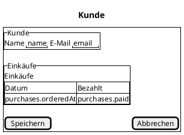

# Pisa — User Guide

Wie man mit Pisa ein Projekt aufsetzt und aus Specs (Domänenmodell, Formularbeschreibung) lauffähigen
Code erzeugt.

> **Pflege:** Dieser Guide beschreibt den Stand von `pisa 0.13.0` (veröffentlicht ist `v0.13.0`; mit `enum`, `@table`, `@column`, `.adl`, `propose-architecture`, `propose-model`, dem zweiten Ziel `hono-prisma` (TypeScript), `runtime` in der `.adl`, `@operations` und die Anmeldung mit Benutzern und Rollen (`authentication session`, `pisa hash-password`), den Rollen in der `.adl`, dem Anzeigemodus der Seiten, `pisa play`, `pisa update-versions` und den Blöcken `pipeline` und `scm` der `.adl`. Er wird bei **jeder** Änderung an Befehlen,
> Optionen, Spec-Formaten oder erzeugtem Verhalten im selben Arbeitsschritt mitgepflegt (Regel in
> der `AGENTS.md` im Repo-Wurzelordner). Wenn etwas nicht stimmt: `pisa --help` und
> [`projects/pisa/README.md`](../../projects/pisa/README.md) sind die Quellen, dieser Guide folgt ihnen.

**Zum Ausprobieren:** `mkdir mein-projekt && cd mein-projekt && pisa init` legt `doc/` (diesen Guide und beide Tutorials) und `spec/` an; `pisa play` nennt die Tutorials, `pisa play <name>` spielt eines ab ([`pisa play`](#pisa-play)). Das [Spring-Java-Tutorial](pisa-tutorial-spring-java.md) führt in einer Stunde von der Prosa-Beschreibung zur laufenden Java-Anwendung (mit den LLM-Vorschlägen); das [Hono-TypeScript-Tutorial](pisa-tutorial-hono-typescript.md) baut dieselbe Anwendung als TypeScript-Projekt mit Hono und Prisma.

Inhalt: [Pisa installieren](#pisa-installieren) · [Editor und PlantUML einrichten](#editor-und-plantuml-einrichten) ·
[Quick Intro](#quick-intro-ein-projekt-bootstrappen-samt-specs) ·
[Konzept](#das-konzept-in-einer-minute) · [Befehle](#befehle) · [Specs](#specs) ·
[Vorlagen anpassen](#vorlagen-anpassen) · [Rezept und Replay](#rezept-und-replay) ·
[Fehler und Hinweise](#häufige-meldungen) · [Noch nicht möglich](#noch-nicht-möglich)

## Neu seit 0.8.0

| Funktion | Kurz | Details |
|---|---|---|
| Zweites Ziel `hono-prisma` | dieselben Specs, daraus eine TypeScript-Anwendung (Node.js, Hono, Prisma) statt Spring Boot | [4f](#4f-dasselbe-projekt-in-typescript-hono-prisma), [TypeScript-Tutorial](pisa-tutorial-hono-typescript.md) |
| `runtime spring \| hono` in der `.adl` | die Zielwahl steht in der Architektur, `init` braucht kein `--target` | [4e](#4e-die-architektur-beschreiben-specadl-optional) |
| `@operations(...)` | eine Entität erlaubt nur bestimmte Operationen (sonst 405, keine Buttons) | [4h](#4h-operationen-einschränken-operations) |
| `authentication session` | Anmeldung mit Benutzern und Rollen (`security.yml`), bcrypt, Passwortwahl beim ersten Login | [4g](#4g-benutzer-rollen-und-anmeldung-authentication-session), [`pisa hash-password`](#pisa-hash-password) |
| `app.title` in `application.yml` (ab 0.9.1) | der Name der Anwendung auf der Startseite, aus der `.adl` vorbelegt | [4e](#4e-die-architektur-beschreiben-specadl-optional) |
| `propose-architecture` mit `authentication session` (**ab 0.10.0**) | das LLM darf die Anmeldung vorschlagen, wenn die Beschreibung sie verlangt | [`propose-architecture`](#pisa-propose-architecture) |
| `roles { … }` in der `.adl` (**ab 0.11.0**) | die Rollen und was jede darf (Rechte pro Entität): `security.yml`, die Tests pro Rolle und der Akteur der Use Cases kommen daraus | [4g](#4g-benutzer-rollen-und-anmeldung-authentication-session) |
| Anzeigemodus (**ab 0.11.0**) | ein Klick auf eine Zeile zeigt den Eintrag schreibgeschützt; wer ändern darf, hat dort «Edit» | [4g](#4g-benutzer-rollen-und-anmeldung-authentication-session) |
| `engine sqlite` in der `.adl` (**ab 0.11.0**) | die eingebettete Datenbank des TypeScript-Ziels beim Namen genannt; nur mit `runtime hono`, bei Spring ein Fehler (`h2` bei Hono gilt weiter als Alias und warnt) | [4c](#4c-der-architekturplan-pisaarchitectureplanjson) |
| `pisa init` ohne Angaben (**ab 0.11.0**) | legt nur `doc/` (diesen Guide und beide Tutorials) und `spec/` an, noch kein Projekt; auch `init` mit Ziel legt `doc/` an | [`pisa init`](#pisa-init) |
| `pisa play <tutorial>` (**ab 0.11.0**) | spielt ein Tutorial ab (Befehle, Dateien, Anwendung starten) und meldet Schritt für Schritt; ohne Sprachmodell, wenn nicht `--llm` | [`pisa play`](#pisa-play) |
| `pisa update-versions` (**ab 0.12.0**) | die neuesten stabilen Versionen der Bibliotheken (Maven Central, npm) in die `versions { }` der `.adl` schreiben, vorher an einer Kopie des Projekts geprüft; was die Prüfung bricht, bleibt auf seiner Version | [`pisa update-versions`](#pisa-update-versions) |
| `pipeline { ci github  release github }`, `scm { host github … }` in der `.adl` und `pisa init --git` (**ab 0.13.0**) | `init` schreibt die CI-Datei (Build und Tests bei jedem Push und Pull Request), den Release-Workflow, die Pull-Request-Vorlage und die Issue-Formulare, je nachdem, was in der `.adl` steht, und legt das Git-Repository mit einem ersten Commit an (Zweig `main`, nur lokal) | [4e](#4e-die-architektur-beschreiben-specadl-optional), [`pisa init`](#pisa-init) |
| `docker { image "…"  compose }` in der `.adl` (**ab 0.13.0**) | `init` schreibt `Dockerfile` und `.dockerignore` und mit `compose` eine `compose.yml`, die die Anwendung (und ihr PostgreSQL) startet; unabhängig davon, ob die Anwendung später in der Cloud läuft | [4e](#4e-die-architektur-beschreiben-specadl-optional) |
| `deploy render` im Block `pipeline` (**ab 0.13.0**) | `init` schreibt `render.yml` (Blueprint des kostenlosen Render-Web-Dienstes) und `.github/workflows/cd.yml` (bei einem Tag `v*` ruft es den Deploy-Hook auf); braucht den Block `docker` | [4e](#4e-die-architektur-beschreiben-specadl-optional) |
| Tests gegen echtes PostgreSQL mit Testcontainers, `mvn test -Ptestcontainers` (**ab 0.13.0**, nur Spring mit `engine postgresql`) und der Abschnitt «Optionale Schritte ausprobieren» | Zusätzlich zu den H2-Tests: Repository-Tests und ein Context-Test gegen ein PostgreSQL im Container; die erzeugte CI nimmt das Profil mit | [4a](#4a-tests-des-erzeugten-projekts), [4i](#4i-optionale-schritte-ausprobieren-auch-ohne-pisa-play) |
| Bootstrap 5 für das Aussehen der Seiten (**ab 0.10.0**) | Menü, Karten, Formulare, Tabellen und Anmeldung nutzen das CSS von Bootstrap 5.3.8 (Spring: WebJar `org.webjars.npm:bootstrap`, Hono: npm `bootstrap`); Plan-Schlüssel `versions.bootstrap`. Ein Projekt aus 0.9.1 oder früher: Schlüssel `"bootstrap": "5.3.8"` in `.pisa/architecture.plan.json` ergänzen, dann `pisa init --force` (Pisa nennt den fehlenden Schlüssel) | – |
| Meldung verwaister Use-Case-Tests (**ab 0.10.0**) | `generate` nennt Browser-Tests, deren Use Case aus `spec/*.uc.md` verschwunden ist | [4h](#4h-operationen-einschränken-operations) |

Mit der Anmeldung zeigt jede Seite rechts oben in der Navigation ein Menü (☰) mit dem angemeldeten Benutzer, «Change password» und «Sign out» (ab 0.9.1). Was als **ab 0.10.0** gekennzeichnet ist, ist mit `v0.10.0` veröffentlicht; was als **ab 0.11.0** gekennzeichnet ist, ist mit `v0.11.0` veröffentlicht; was als **ab 0.12.0** gekennzeichnet ist, mit `v0.12.0`; was als **ab 0.13.0** gekennzeichnet ist, mit `v0.13.0`.

---

## Pisa installieren

Pisa ist ein einzelnes, fertig kompiliertes Programm (kein Bun, kein Node, keine Abhängigkeiten). Es
liegt als Datei im [GitHub-Release](https://github.com/colameo/FFHSCAS/releases) des Repos
`colameo/FFHSCAS`:

| System | Datei |
|---|---|
| macOS, Apple Silicon (M1 und neuer) | `pisa-darwin-arm64` |
| macOS, Intel | `pisa-darwin-x64` |
| Linux, x86-64 | `pisa-linux-x64` |
| Linux, ARM | `pisa-linux-arm64` |
| Windows, x86-64 | `pisa-windows-x64.exe` |
| Windows, ARM | `pisa-windows-arm64.exe` |

Welche Architektur du hast, zeigt `uname -m` (macOS/Linux: `arm64`/`aarch64` = ARM, `x86_64` = x64)
bzw. unter Windows *Einstellungen → System → Info → Systemtyp*.

**Das Repo ist privat.** Ein `curl` auf die Download-URL ohne Anmeldung liefert «404». Zwei Wege:

- **Im Browser:** bei GitHub angemeldet die Release-Seite öffnen, unter *Assets* die Datei laden.
- **Mit der GitHub-CLI** (`gh`, einmal `gh auth login`): Befehle unten. `gh` gibt es per
  `brew install gh`, `sudo apt install gh` bzw. `winget install GitHub.cli`.

### Mit Skript (macOS, Linux, Windows in Git Bash/WSL)

[`AISE/projects/install-pisa.sh`](../../projects/install-pisa.sh) erkennt System und CPU, lädt die
passende Datei mit `gh`, macht sie ausführbar, entfernt auf macOS die Quarantäne und prüft, ob der
Ordner im PATH liegt:

```bash
AISE/projects/install-pisa.sh                          # neuestes Release nach ~/.local/bin
AISE/projects/install-pisa.sh --version v0.2.0 --dir ~/.bin
```

Ohne ausgechecktes Repo kann `gh` das Skript selbst holen (sobald es auf GitHub liegt):

```bash
gh api repos/colameo/FFHSCAS/contents/AISE/projects/install-pisa.sh -H 'Accept: application/vnd.github.raw' | bash
```

Das Skript braucht `gh` (angemeldet) und sonst nichts. Getestet auf macOS (Apple Silicon): neuestes
Release, ältere Version, unbekannte Version. Die Linux- und Git-Bash-Zweige sind nicht ausprobiert.
Reines PowerShell ohne Git Bash: `install-pisa.ps1` (nächster Absatz).

**Windows (PowerShell):** [`AISE/projects/install-pisa.ps1`](../../projects/install-pisa.ps1) macht dasselbe
mit den Optionen `-Version` und `-Dir` (Standard `$HOME\bin`). Es wählt `x64` oder `arm64`, lädt mit
`gh`, legt `pisa.exe` ab, hebt die «aus dem Internet»-Markierung auf und trägt den Ordner in den
Benutzer-PATH ein (neues Terminal öffnen):

```powershell
.\AISE\projects\install-pisa.ps1
.\AISE\projects\install-pisa.ps1 -Version v0.2.0 -Dir C:\Tools\pisa
# Skripte gesperrt?  powershell -ExecutionPolicy Bypass -File .\AISE\projects\install-pisa.ps1
```

Das Skript ist auf macOS mit `pwsh` geprüft (Syntax, Download, Ablage, PATH-Eintrag, Fehlerfälle),
das Starten von `pisa.exe` selbst und die Windows-spezifischen Teile (`Unblock-File`, Benutzer-PATH)
sind auf einem echten Windows nicht ausprobiert.

Von Hand, pro System:

### macOS

```bash
gh release download --repo colameo/FFHSCAS --pattern 'pisa-darwin-arm64' -O pisa   # Intel: pisa-darwin-x64
chmod +x pisa
mkdir -p ~/.bin && mv pisa ~/.bin/pisa        # ~/.bin muss im PATH liegen (z. B. in ~/.zshrc)
xattr -d com.apple.quarantine ~/.bin/pisa     # nur nötig, wenn du die Datei im Browser geladen hast
pisa --version
```

Meldet macOS beim Start «kann nicht geöffnet werden», ist es die Quarantäne von Gatekeeper: der
`xattr`-Befehl oben behebt sie.

### Linux

```bash
gh release download --repo colameo/FFHSCAS --pattern 'pisa-linux-x64' -O pisa      # ARM: pisa-linux-arm64
chmod +x pisa
mkdir -p ~/.local/bin && mv pisa ~/.local/bin/pisa   # oder: sudo mv pisa /usr/local/bin/pisa
pisa --version
```

Das gilt auch für eine Linux-VM (Lima, Docker, WSL).

### Windows (PowerShell)

```powershell
gh release download --repo colameo/FFHSCAS --pattern 'pisa-windows-x64.exe' -O pisa.exe
mkdir $HOME\bin -Force; Move-Item pisa.exe $HOME\bin\pisa.exe
setx PATH "$env:PATH;$HOME\bin"        # wirkt erst in einem neuen Terminal
pisa --version
```

Beim ersten Start warnt SmartScreen unter Umständen («Weitere Informationen → Trotzdem ausführen»).
Im Browser geladen: Datei in `pisa.exe` umbenennen und in einen Ordner legen, der im PATH steht.
`build-all.sh` und `release.sh` sind Bash-Skripte (Git Bash oder WSL), unter Windows nimmst du die
fertigen Release-Dateien. *Auf Windows nicht getestet.*

### Aktualisieren und Quellcode

Neue Version: dieselbe Datei erneut laden und ersetzen. `pisa --version` zeigt, was läuft. Wer aus dem
Quellcode bauen will (Bun, `bun run compile`): Abschnitt «Install» und «Building the binary» in
[`projects/pisa/README.md`](../../projects/pisa/README.md).

---

## Editor und PlantUML einrichten

Zwei Dinge machen die Arbeit mit den Specs angenehm, beide sind optional:

1. **Pisa-Plugin «Pisa Languages (DML, ADL)»** für `.dml` (und `.adl`, die Architektur-Sprache, die Pisa noch nicht liest): Syntaxfarben, Fehler beim
   Tippen, und beim Speichern einer `.dml` schreibt es das Klassendiagramm des Modells (`domain-model.puml` und
   `domain-model.md` neben den `.dml`). Die Plugins können `.dml` und `.adl` auch formatieren (VS Code: «Format Document»;
   IntelliJ: Reformat Code, falls LSP4IJ-Formatierung aktiv ist, nicht geprüft). Stil: 4 Leerzeichen, `{` am Zeilenende, ein Feld
   pro Zeile, `name: Typ`, eine Leerzeile zwischen Entitäten. Eine Datei mit Syntaxfehler wird nicht verändert.
2. **PlantUML**, damit das Diagramm und die Salt-Mockups in `.ui.md` als Bild erscheinen.

### Pisa-Plugin für IntelliJ

Voraussetzungen: IntelliJ IDEA ab 2024.3 (Build 243) und **Node.js** (der Sprachserver läuft mit
`node`). Das Plugin sucht `node` im PATH deiner Shell, bei nvm und in den üblichen Homebrew-Ordnern;
unter macOS findet eine über das Dock gestartete IDE manchmal keins. Dann die Umgebungsvariable
`DML_NODE` auf die ausführbare Datei setzen (z. B. `export DML_NODE=$(which node)` und die IDE aus
dem Terminal starten).

**Windows:** Das Plugin sucht nur nach `node`, nicht nach `node.exe`, und kennt nvm-windows nicht. Es
findet Node dort deshalb nicht von selbst: `DML_NODE` ist **Pflicht**, dauerhaft gesetzt, dann die IDE
neu starten:

```powershell
winget install OpenJS.NodeJS.LTS
setx DML_NODE "C:\Program Files\nodejs\node.exe"
```

(Pfad bei anderer Installation anpassen, `where node` zeigt ihn.)

1. `dml-intellij-plugin-<version>.zip` holen: aus dem GitHub-Release, oder selbst gebaut mit
   `AISE/projects/build-all.sh` (gibt den Pfad aus; Quelle `projects/dml-intellij-plugin`).
2. *Settings → Plugins → ⚙ → Install Plugin from Disk…* und die Zip wählen. Die Abhängigkeit
   **LSP4IJ** installiert IntelliJ aus dem Marketplace gleich mit (sonst von Hand installieren).
3. IDE neu starten. Öffne eine `.dml`: Farben und Fehlermeldungen erscheinen, der Server heisst
   «Pisa Language Server (DML, ADL)» (Fenster *Language Servers* von LSP4IJ zeigt seinen Zustand).

Das Plugin enthält den Sprachserver; eine Zip ersetzt eine frühere Version.

### Pisa-Extension für VS Code

Voraussetzung: VS Code ab 1.85. Der Sprachserver ist in der Extension gebündelt und läuft im
VS-Code-eigenen Node, eine eigene Node-Installation ist nicht nötig.

```bash
code --install-extension dml-vscode-extension-<version>.vsix
```

oder *Extensions → ⋯ → Install from VSIX…*. Die `.vsix` kommt aus dem GitHub-Release oder von
`AISE/projects/build-all.sh` (installiert sie zusätzlich in dein lokales VS Code). Danach öffnet jede
`.dml`-Datei mit Syntaxfarben und Prüfung.

### PlantUML im System

Das Diagramm- und Mockup-Rendering braucht PlantUML und Graphviz (`dot`) auf dem Rechner, wenn ein
Plugin den lokalen Weg benutzt.

```bash
# macOS (Homebrew)
brew install plantuml graphviz
# Debian/Ubuntu
sudo apt install plantuml graphviz
```

```powershell
# Windows (Chocolatey; mit Scoop: scoop install plantuml graphviz)
choco install plantuml graphviz
# Java, falls noch keins da ist
winget install EclipseAdoptium.Temurin.25.JDK
```

Auf Windows muss `dot.exe` im PATH liegen (neues Terminal öffnen und `dot -V` prüfen); sonst die
Umgebungsvariable `GRAPHVIZ_DOT` auf `C:\Program Files\Graphviz\bin\dot.exe` setzen. Prüfen: `plantuml -version` und `dot -V`. PlantUML braucht Java (JDK 17 oder neuer, das hast du für
Spring ohnehin). Pisa selbst ruft PlantUML **nicht** auf, es schreibt nur den Text.

### PlantUML in IntelliJ

Plugin **PlantUML integration** installieren (*Settings → Plugins → Marketplace*, Suche «PlantUML integration»;
Plugin-ID `plantuml4idea`). Es bringt ein eigenes
PlantUML mit; *Settings → Languages & Frameworks → PlantUML* erlaubt ein eigenes `plantuml.jar` und
den Pfad zu Graphviz (sonst werden manche Diagramme nicht gezeichnet, Salt-Mockups kommen ohne
Graphviz aus). Danach zeigt IntelliJ `.puml`-Dateien im Vorschaufenster.

Für ```` ```plantuml ````-Blöcke in Markdown (`domain-model.md`, `.ui.md`) soll die Markdown-Vorschau
das Bild zeigen. Das ist die Arbeitsweise, die Pisa voraussetzt (der Salt-Vorschauabschnitt der
`.ui.md` ist dafür gedacht), im Guide aber nicht für jede IDE-Version geprüft. Erscheint nur der
Quelltext, in *Settings → Languages & Frameworks → Markdown* nach einer PlantUML-Erweiterung suchen.

### PlantUML in VS Code

Extension **PlantUML** (`jebbs.plantuml`) installieren:

```bash
code --install-extension jebbs.plantuml
```

`Alt+D` (macOS: `Option+D`) zeigt die Vorschau einer `.puml` oder eines ```` ```plantuml ````-Blocks. Sie rendert lokal mit Java
und Graphviz (siehe oben, `plantuml.render` = `Local`, das ist der Standard).

**Die Markdown-Vorschau** (`Cmd+Shift+V`, die Diagramme in `domain-model.md` und `.ui.md`) rendert die Extension **nicht** lokal:
sie bindet Bilder von einem PlantUML-Server ein. Ist `plantuml.server` leer, steht dort `No PlantUML server, specify one with
"plantuml.server"`, auch wenn `plantuml.render` auf `Local` steht und Java und Graphviz installiert sind (im Quelltext der Extension 2.18.1
nachgelesen: `markdown-it-plantuml/render.js`). Zwei Wege:

- **Eigener Server auf dem Rechner** (die Diagramme verlassen ihn nicht; Docker nötig, der Befehl ist hier nicht ausprobiert):

  ```bash
  docker run -d --name plantuml -p 8090:8080 plantuml/plantuml-server:jetty
  ```

  und in den Settings (JSON) `"plantuml.server": "http://localhost:8090"`. Port 8090, weil 8080 die erzeugten Anwendungen belegen.
- **Öffentlicher Server:** `"plantuml.server": "https://www.plantuml.com/plantuml"`. Dann gehen die Diagramme ins Netz: für
  vertrauliche Modelle nicht verwenden.

> Nicht in diesem Guide geprüft: die Oberflächen der Einstellungsdialoge ändern sich zwischen
> IDE-Versionen. Massgeblich sind die Menünamen deiner Version.

---

## Quick Intro: ein Projekt bootstrappen samt Specs

Ziel: in etwa zehn Minuten ein laufendes Spring-Boot-Projekt mit REST-API und Weboberfläche für ein
Domänenmodell, ohne LLM und ohne Netzwerk. (Wer es lieber geführt hat: `pisa init` in einem neuen Ordner, dann `pisa play` und die Tutorials in `doc/`, siehe oben.)

### Voraussetzungen

- `pisa` im Pfad (`pisa --version` zeigt z. B. `pisa 0.3.0 (built …)`), siehe
  [Pisa installieren](#pisa-installieren).
- JDK 25 (die aktuelle LTS; mit `--java` gehen auch 17 und 21) und Maven, um das erzeugte Projekt zu starten (Windows: `choco install maven`
  oder Scoop). Die Befehle im Guide sind für Bash geschrieben; in PowerShell ist `\` am Zeilenende durch
  `` ` `` zu ersetzen, `cd` und `--out .` gehen unverändert.
- Empfohlen: die Pisa-Plugins (DML, ADL) und PlantUML für deinen Editor ([Einrichtung](#editor-und-plantuml-einrichten)).
  Pisa läuft auch ohne, aber `.dml` hat dann weder Prüfung noch Diagramm und die Mockups bleiben Text.
- Ein LLM-Zugang ist **nur** für die `propose-…`-Befehle mit LLM nötig (`propose-model`, `propose-architecture`, `propose-layout`; `propose-specs` braucht keinen). Dieser Guide
  braucht keinen: Modell und Mockup schreibst bzw. zeichnest du selbst.

### 1. Projekt anlegen (`init`)

```bash
pisa init --target spring-boot --out ./shop --group ch.example --artifact shop
```

Das erzeugt ein startbares, leeres Spring-Boot-Projekt (`pom.xml`, Application-Klasse, Test,
`application.yml` mit H2-URL, Benutzer und Konsole, `GlobalExceptionHandler`, `README.md`), den Ordner **`spec/`** mit einer kurzen
englischen `spec/README.md` (welche Spec-Dateien es gibt, DML-Kurzreferenz, ein Formular- und ein Use-Case-Beispiel, «Nächste Schritte» und ein Verweis auf das Tooling: Pisa-Plugin, PlantUML)
und die erste Spec des Projekts: **`project.spec.json`**. Dazu kommt der Ordner **`doc/`** mit diesem User Guide und beiden Tutorials (so sind sie dort, wo die Specs entstehen, und passen zur Pisa-Version, die das Projekt angelegt hat; sie gehören nicht zum Rezept; ein `pisa init` ganz ohne Angaben legt nur `doc/` und `spec/` an, siehe `pisa init`). Eine bereits vorhandene (auch bearbeitete)
`README.md` oder `spec/README.md` überschreibt `init` nie, auch nicht mit `--force`; Dateien in `doc/` bleiben, bis du `--force` angibst. Das Haupt-README nennt zuerst Pisa/DSDD, dann «Tooling» (JDK, Maven, Pisa) und «Next steps».

```json
{
  "target": "spring-boot",
  "groupId": "ch.example",
  "artifactId": "shop",
  "basePackage": "ch.example.shop",
  "javaVersion": "25",
  "database": "h2"
}
```

`project.spec.json` hält fest, *was für ein Projekt* es ist (Ziel-Technologie und Optionen). Alle
folgenden Befehle lesen es, du musst `--target` nicht mehr angeben.

### 2. Domänenmodell schreiben (`spec/*.dml`)

Das Modell gehört ins Projekt, in den Ordner `spec/` (den `init` angelegt hat, samt einer kurzen
`spec/README.md`, die erklärt, wie man Domänenmodell, Formulare und Use Cases definiert; `init` weist am
Ende darauf hin). Lege `spec/shop.dml` an:

```
entity Customer {
    @id id: Long
    name: String
    email: String? unique
    oneToMany purchases: Purchase mappedBy customer
}

entity Purchase {
    @id id: Long
    orderedAt: Date
    paid: Boolean
    manyToOne customer: Customer
}
```

Kurzreferenz der `.dml`-Sprache: [Domänenmodell](#domänenmodell-dml). Die Dateien in `spec/` bilden
zusammen **ein** Modell (Entitäten dürfen sich über Dateien hinweg referenzieren).

### 3. Code erzeugen (`generate`)

```bash
cd shop
pisa generate --file spec/shop.dml --out .     # prüft Syntax und Verweise, schreibt erst dann
```

Pro Entität entstehen JPA-Klasse, Spring-Data-Repository, REST-Controller (`/api/customers`,
`/api/purchases`, mit Paging) und eine Alpine.js-Seite (Liste, Anlegen, Bearbeiten, Löschen). Dazu
`index.html` (Menü) und ein Klassendiagramm des Modells (`spec/domain-model.md`, `.puml`).
Die Dateien unter `src/` werden bei jedem Lauf neu geschrieben — das ist der erzeugte Teil.

### 4. Starten

```bash
mvn spring-boot:run
```

- Oberfläche: <http://localhost:8080/>
- API: <http://localhost:8080/api/customers>
- Datenbank: H2 im Speicher (Daten sind nach dem Neustart weg).

### 4h. Operationen einschränken (`@operations`)

**Idee:** Standardmässig kann man mit jeder Entität alles tun: **anlegen** (`create`), **lesen** (`read`), **ändern** (`update`), **löschen** (`delete`).
Soll das für eine Entität nicht gelten, steht es im Domänenmodell, nicht im Code. Ohne Angabe ist immer alles erlaubt; Pisa sperrt nie von sich aus etwas
und die LLM-Vorschläge (`propose-model`, `propose-specs`) schlagen es auch nicht vor.

**Wann `@operations`, wann `security.yml`?** `@operations` beschreibt die **Entität**: etwas, das für alle gilt und zum Wesen der Daten gehört
(Referenzdaten, Importe, Protokolleinträge: nie löschen, nie ändern). Es steht im Modell, weil Pisa es gegen die Use Cases prüft, und die Anwendung antwortet **405**.
Was **je nach Rolle** erlaubt ist («Sachbearbeiter dürfen Firmen nur lesen»), gehört in `security.yml` (4g); dort antwortet die Anwendung **403**.
`security.yml` kann nie mehr erlauben, als `@operations` zulässt.

```
@operations(create, read, update)       // Firmen: kein Löschen
entity Company {
    @id id: Long
    name: String unique
    oneToMany employees: Person mappedBy company
}
```

Die Zeile steht nach `@table` (falls vorhanden) und vor `entity`. Regeln, die der Editor und `generate` prüfen:

- `read` muss dabei sein (Listen und die Auswahlfelder anderer Entitäten brauchen es; «nur schreiben» gibt es nicht).
- Erlaubte Namen: `create`, `read`, `update`, `delete`, keine doppelt. Sie sind keine Schlüsselwörter: ein Feld `read` oder ein Enum-Wert `DELETE` bleibt möglich.
- Auf einem `composed`-Bestandteil (z. B. `Address` einer `Person`) ist die Angabe ein Fehler: er wird mit seiner Wurzel bearbeitet, dort gehört sie hin.

**Was in der Anwendung passiert** (gleich in beiden Zielen, Spring und TypeScript):

| Stelle | Ohne `delete` (Beispiel) | Ohne `create` | Ohne `update` |
|---|---|---|---|
| REST-Schnittstelle | `DELETE /api/companies/<id>` antwortet **405** mit `Allow`-Header | `POST` antwortet 405 | `PUT` antwortet 405 |
| Seite der Entität | kein Delete-Button | kein Formular zum Anlegen | kein Edit-Button; das Formular erscheint nur zum Anlegen (`create`) und zum Anzeigen (Klick auf eine Zeile, ohne Speichern-Button, mit «Edit» nur wo `update` erlaubt ist) |
| Tabelle in der Seite einer anderen Entität | – | – | «Open» führt nur zur Seite, nicht ins Formular |
| Erzeugte Tests | Test `answers405ForADelete` bzw. `answers 405 for a delete` statt des Löschtests | die Fehlerfälle beim Anlegen entfallen; Testdaten kommen direkt aus dem Repository | Test auf 405 statt des Änderungstests |

Repository und Service bleiben vollständig: die Sperre gilt an der Schnittstelle und in den Seiten, nicht im Code darunter.
Eine nicht erlaubte Operation antwortet immer **405**, auch für `ADMIN` (siehe [4g](#4g-benutzer-rollen-und-anmeldung-authentication-session)): 405 heisst «die Entität kennt das nicht», 403 «du darfst das nicht».

**Zusammenspiel mit anderen Specs:**

- **Rollen:** die Rechte einer Rolle in `security.yml` werden mit `@operations` **geschnitten**. Hat `ADMIN` `"*": [create, read, update, delete]` und `Company` nur `@operations(create, read, update)`, darf auch `ADMIN` keine Firma löschen.
  `GET /api/me` und die Seiten zeigen das schon geschnitten.
- **Use Cases:** ein Use Case (`.uc.md`) mit `Test: löschen` verlangt `delete` (`ändern`: `update`, `anlegen`: `create`; bei einem Bestandteil gilt die Wurzel). Fehlt es, bricht `generate` **ab und schreibt nichts**:
  `UC6 (spec/use-cases.uc.md): Company doesn't allow "delete" (@operations(create, read, update)) but the test line says "delete"`.
  Ausweg: die Operation wieder erlauben, die `Test:`-Zeile ändern oder den Use Case streichen.
- **Pisa löscht nie:** streichst du einen Use Case, bleibt sein alter Browser-Test (`test/ui/UC6.spec.ts` bzw. `…/ui/UC6UiTest.java`) liegen und schlägt fehl; **von Hand löschen**. `generate` nennt ihn: `Info: browser tests of use cases that are no longer in spec/*.uc.md - delete …`, eine Datei pro Zeile. Hebst du eine Sperre auf, schreibt `generate` die Tests und Seiten der Entität wieder voll.

**Zurück zu «alles erlaubt»:** die `@operations`-Zeile löschen (oder alle vier Namen nennen) und `generate`. Beispiel mit Schritten und Ausgaben: [Tutorial](pisa-tutorial-spring-java.md), Schritt 7a (TypeScript: [Tutorial](pisa-tutorial-hono-typescript.md), Schritt 7a).

### 4g. Benutzer, Rollen und Anmeldung (`authentication session`)

Standardmässig hat die Anwendung **keine Anmeldung, alles ist offen**. Mit einer Zeile in der `.adl` bekommt sie eine Anmeldung mit
Benutzern und Rollen, in beiden Zielen gleich:

```
    container api : backend {
        authentication session     // fehlt die Zeile: keine Anmeldung
        …
    }
```

**Rollen und ihre Rechte** stehen in der `.adl`, im Block `roles` (er braucht `authentication session`; die Rechte stehen **nicht** im Domänenmodell):

```
    container api : backend {
        authentication session
        roles {
            ADMIN                      // eine Rolle ohne Block darf alles, was die Entitäten erlauben
            USER {
                Company: read, update  // nur diese Operationen auf dieser Entität (create, read, update, delete)
            }                          // alle übrigen Entitäten bleiben erlaubt; `*: read` setzt es für «alle anderen»
        }
        …
    }
```

Fehlt der Block, gibt es die Rollen `ADMIN` und `USER`, beide dürfen alles. Der Editor prüft den Block (eine Rolle nur einmal, eine Entität nur einmal je Rolle,
nur die vier Operationen; ein Name, den die `.dml` im selben Ordner nicht kennt, ist eine Warnung) und springt vom Entitätsnamen zur Entität (*Go to Definition*, in IntelliJ Ctrl+Klick; *Find References* listet die Regeln, die denselben Namen nennen); ob die Entitäten im Modell vorkommen, prüft `generate` (`security.yml is not valid: … no entity …`). `propose-architecture` schreibt den Block aus der Beschreibung,
wenn sie Rollen und ihre Rechte nennt («User darf Firmen lesen und ändern, aber nicht anlegen oder löschen»).

`init` (neu: `init … --adl … --force`) schreibt dann **einmal** die Datei `security.yml` in den Projektordner (danach gehört sie dir, Pisa überschreibt sie nie; **eine bestehende `security.yml` vorher löschen**, damit sie aus den Rollen der `.adl` neu entsteht),
die Anmeldeseite `login.html` und die Seite `change-password.html`. Jede Rolle bekommt einen Entwicklungsbenutzer: `admin` für `ADMIN`, `user` für `USER`, bei jeder anderen Rolle der Rollenname in Kleinbuchstaben (Passwort `user`, bei der ersten Anmeldung zu ändern).

```yaml
roles:                                   # was eine Rolle pro Entität darf ("*" = jede Entität)
  ADMIN:
    "*": [create, read, update, delete]
  USER:
    "*": [create, read, update, delete]
    "Company": [read, update]            # die Liste einer Entität ersetzt "*"
users:
  - { name: admin, password: "$2b$10$…", roles: [ADMIN], mustChangePassword: true }
  - { name: user,  password: "$2b$10$…", roles: [USER],  mustChangePassword: true }
```

- **Rechte:** die Vereinigung der Rollen eines Benutzers, **geschnitten mit `@operations`** der Entität (eine Rolle kann nie mehr, als die Entität erlaubt).
  Eine neue Rolle oder ein neuer Benutzer braucht kein `generate`, nur einen Neustart der Anwendung (sie liest die Datei beim Start).
- **Anzeigemodus:** ein Klick auf eine Zeile der Liste öffnet den Eintrag im Formular, **schreibgeschützt** (alle Felder gesperrt, kein Speichern-Button, «Close» schliesst). Wer `update` darf, sieht dort zusätzlich «Edit», das das Formular entsperrt; der Button «Edit» in der Zeile
  bearbeitet wie bisher direkt. Eine Rolle ohne `update` (oder eine Entität mit `@operations` ohne `update`) kann Einträge also ansehen, auch Felder, die nicht als Spalte in der Liste stehen, aber nicht ändern. Das Verhalten folgt allein aus den Rechten; einstellen lässt es sich in den Specs heute nicht
  (nur über eigene Seitenvorlagen, siehe `pisa eject-templates`). Ein Link `<seite>.html#view=<id>` öffnet einen Eintrag im Anzeigemodus, `#edit=<id>` im Formular; «Open» in der Tabelle einer anderen Seite nimmt `#view=`, wenn die Zielentität nicht geändert werden darf.
- **Antworten:** nicht angemeldet: die API **401** (JSON), eine Seite leitet auf `login.html`; angemeldet ohne Recht: **403**; was die Entität gar nicht erlaubt: weiter **405**.
  `GET /api/me` liefert `{name, roles, mustChangePassword, permissions}`; die Seiten zeigen damit nur Buttons und Formular, die die Rolle braucht, und rechts oben in der Navigation ein Hamburger-Menü (☰) mit «Signed in as …», «Change password» und «Sign out» (schliesst mit Esc oder einem Klick daneben).
- **Passwörter gibt es nirgends im Klartext, und in `security.yml` gar keine** (ab 0.13.0). Ein Benutzer startet mit dem **Passwort seines Namens** (`admin/admin`, `user/user`: öffentlich bekannt, nur für die Entwicklung); die Anwendung hasht es beim Start. Soll ein Benutzer mit einem anderen starten, gibt es optional `password:` mit einem bcrypt-Hash (`$2b$10$…`); `generate` und die Anwendung lehnen einen Eintrag ab, dessen `password` kein Hash ist.
- **Wo die Dateien liegen:** Spring: `src/main/resources/security.yml` (Classpath, im Jar: Änderung und neuer Start oder Bau), Hono: `security.yml` im Projektordner (Änderung und Neustart). Die gewählten Passwörter stehen **nicht** in einer Datei, sondern in der Tabelle `usr_password` der Datenbank der Anwendung (Name, bcrypt-Hash; Spring legt sie beim Start mit `CREATE TABLE IF NOT EXISTS` an, Hono hat das Prisma-Modell `UsrPassword`).
- **Erste Anmeldung:** mit `mustChangePassword` (Standard: `true`, solange `false` nicht dasteht) bekommt man nach der Anmeldung die Seite `change-password.html`, auf der das neue Passwort
  **zweimal** eingegeben wird (mindestens 8 Zeichen, höchstens 72 Bytes, nicht der Benutzername). Bis dahin beantwortet die Anwendung alles andere mit **403 `password change required`**. Der Hash des neuen Passworts
  landet **in der Tabelle `usr_password`**; `security.yml` bleibt unverändert, mit allen Kommentaren. Später ändert man es im Menü (☰) über «Change password».
  Vergessen: die Zeile des Benutzers in `usr_password` löschen setzt auf das Startpasswort zurück. **Mit H2 im Speicher ist die Tabelle nach jedem Neustart leer** (dann gelten wieder Startpasswort und erzwungene Änderung); mit PostgreSQL und SQLite bleibt das Passwort. **Umstieg von 0.12.x:** `init --force` löscht das alte `security.yml` im Projektordner (Spring, wenn unverändert) und meldet `passwords.yml`; die gewählten Passwörter von früher gelten nicht mehr.
- **Eigener Benutzer oder Hash:** `pisa hash-password` fragt das Passwort zweimal ohne Echo ab (oder `--stdin`; nie als Argument, die Shell würde es behalten) und druckt den bcrypt-Hash, den man als `password:` einträgt.
  bcrypt gibt es in Java (`BCryptPasswordEncoder`) und in JavaScript (`bcryptjs`): dieselbe Datei geht in beiden Zielen.
- **Sitzung:** Cookie, bei Spring mit CSRF-Token (die Seiten schicken `X-XSRF-TOKEN`), bei TypeScript `HttpOnly` und `SameSite=Lax`. `H2`-Konsole (Spring): nur für `ADMIN`.
- **Tests:** die erzeugten Tests melden sich als Testbenutzer an, die **nicht** in deiner `security.yml` stehen, sondern in einer Testdatei (`src/test/resources/security-test.yml` bzw. `test/security-test.yml`, von `generate`
  geschrieben, nur Hashes): `tester` darf alles, was die Entitäten erlauben, `nobody` nichts, `newcomer` und `newbie` müssen ein Passwort wählen. `SecurityTest` bzw. `test/api/security.test.ts` prüfen 401/403, das Formular,
  `/api/me` und das Setzen des Passworts (die geschriebene Datei hat nur einen Hash); ein Browser-Test geht den ersten Login durch.
  **Je Rolle** der `.adl` steht ein Testbenutzer `as-<rolle>` in der Testdatei (`as-admin`, `as-user`); `RolesTest` bzw. `test/api/roles.test.ts` prüfen für jede Rolle und jede Entität, was `/api/me` listet, dass eine erlaubte Operation nicht mit 403 endet
  und eine nicht erlaubte mit 403 (`create`, `read`, `update`, `delete`; was `@operations` gar nicht erlaubt, fehlt: das ist die 405). Die Tests folgen den Rollen der `.adl`, nicht einer von Hand geänderten `security.yml`.
- **Zurück auf «keine Anmeldung»:** die Zeile aus der `.adl` nehmen, `init … --force` und `generate`. Die Dateien der Anmeldung (`SecurityStore`, `SecurityConfig`, `EntityAccess`, `SecurityController`, die Seiten bzw. `src/lib/security.ts`)
  werden gelöscht, wenn du sie nicht geändert hast (sonst bleiben sie liegen und werden mit dem `rm`-Befehl gemeldet, siehe 4c); sie brauchen Spring Security bzw. `bcryptjs`, die `pom.xml`/`package.json` dann nicht mehr haben. `security.yml` und `passwords.yml` bleiben dir.

**Nicht möglich:** Benutzer im Browser anlegen oder verwalten, Passwort zurücksetzen per E-Mail, Token (JWT) oder externe Anbieter (Keycloak/OIDC), Rechte pro Feld oder Zeile, HTTPS (das Passwort geht bei der Anmeldung im Klartext über die Leitung, solange die Anwendung über HTTP läuft:
Entwicklung), Begrenzung der Anmeldeversuche. Beispiel: `projects/dml-lang/example/architectures/session/architecture.adl`.

### 4f. Dasselbe Projekt in TypeScript (`hono-prisma`)

Aus denselben Specs (`.dml`, `.ui.md`, `.uc.md`) macht Pisa auch eine TypeScript-Anwendung: Node.js 24 (führt
TypeScript direkt aus, kein Build-Schritt), **Hono** für HTTP, **Prisma** für die Datenbank. Die REST-Schnittstelle
(`/api/<entität>`, Seiten mit `?page=&size=`, Sammlungen unter `/api/<entität>/<id>/<sammlung>`) und die Seiten
(Alpine.js, dieselben Vorlagen wie bei Spring) sind dieselben; ein Browser merkt den Unterschied nicht.

Gewählt wird das Ziel in der `.adl`, mit **einer Zeile im Backend**:

```
    container api : backend {
        runtime hono               // spring (Standard) | hono
        uses db
        components layered         // crud | layered
    }
```

```bash
pisa init --out ./library-ts --adl library.adl      # --target ist nicht nötig: das Ziel steht in der .adl
cd library-ts                                       # die .dml, .ui.md und .uc.md nach spec/ legen
pisa generate --file spec/library.dml --out .
npm install
npm start                                           # http://localhost:8080/
```

Ohne `runtime` gilt `--target`, sonst Spring Boot. Nennen beide etwas, müssen sie übereinstimmen (sonst stoppt `init`).
Ändert man `runtime` in einem bestehenden Projekt, stoppt `generate` mit der Abweichung und dem Befehl `pisa init … --adl … --force`.

| Spring Boot | Hono + Prisma |
|---|---|
| `pom.xml`, `application.yml` (Datenbank, `app.title`) | `package.json`, `prisma.config.ts`, `src/db.ts`, `application.yml` (`app.title`) |
| JPA-Klasse, Repository, Controller | `src/model`, `src/repository`, `src/route` (Stil `layered`: zusätzlich `src/service`, `src/dto`, `src/mapper`) |
| Hibernate legt die Tabellen an | `prisma/schema.prisma` (von `generate` geschrieben), `npm start` ruft `prisma db push` |
| H2 (`engine h2`) / PostgreSQL | SQLite-Datei `<name>.db` (`engine sqlite`) / PostgreSQL |
| `mvn test`, `mvn test -Pui` | `npm test` (`node:test`: API-Tests, Schichten-Test), `npm run test:ui` (Playwright); `bun test` leitet an `npm test` weiter (`bunfig.toml`, `test/bun/`): Bun selbst kann Prismas SQLite-Treiber nicht laden und hielte die Browser-Tests für seine eigenen |
| `ArchitectureTest` (ArchUnit) | `test/architecture.test.ts` (Import-Regeln: Route → Service → Repository, nur `db.ts` kennt Prisma) |

Die Tests laufen auf Node.js; wer `bun test` tippt, bekommt denselben Lauf (ein Test startet `npm test`). Zum ersten Mal Browser-Tests: `npx playwright install chromium`. Das `README.md` des erzeugten Projekts enthält alles zum Aufbauen, Starten und Testen (Werkzeuge mit Versionen, drei Wege zum Projekt, alle Befehle, Ports, Datenbank, einzelne Tests, Änderungen, Fehlertabelle). Nicht `prisma db push --force-reset` benutzen (löscht alle Daten).

**Grenzen (Stand jetzt):** nicht unterstützt sind `manyToMany`, `oneToMany` ohne `mappedBy` und `oneToOne` ohne `composed`
(Pisa meldet das mit «not supported by this target yet»); Ids sind immer 32-Bit-`Int` (auch bei `Long`); `package` und
`versions` der `.adl` gelten für Java (`package` wird ignoriert, Versionen stehen in `.pisa/architecture.plan.json`, z. B. `hono`, `prisma`);
PostgreSQL (`docker compose up -d`) ist gegen einen echten Container geprüft (`postgres:17`, 2026-10-21). Beispiel: `AISE/samples/library-hono`
(dieselben Specs wie `library-spring`, nur `runtime hono`). Schritt für Schritt: das [TypeScript-Tutorial](pisa-tutorial-hono-typescript.md).
Die Versionen (npm) hält [`pisa update-versions`](#pisa-update-versions) aktuell, wie bei Spring.


### 4e. Die Architektur beschreiben (`spec/*.adl`, optional)

Statt `.pisa/architecture.plan.json` von Hand zu schreiben, kannst du die Architektur in einer `.adl`-Datei
beschreiben (Sprache der Pisa-Plugins, mit Farben, Fehlern, Vervollständigung und Formatierung). Sie gliedert nach
den C4-Ebenen: **Container** (Datenbank, Backend, Frontend) und im Backend die **Komponenten** (`crud` oder
`layered`); der Code ist die `.dml`.

```
architecture Library {
    container main : database {
        engine postgresql          // h2 (nur runtime spring) | sqlite (nur runtime hono) | postgresql
        name library
    }
    container api : backend {
        runtime spring             // spring (Standard) | hono, siehe 4f
        package ch.ffhs.cas.library
        uses main                  // die Datenbank dieses Backends
        components layered         // crud | layered
        versions { archunit "1.6.0" }
    }
    container web : frontend {
        servedBy api               // eingebettet: das Backend liefert die Seiten
    }
    scm {                          // optional: Vorlagen für GitHub, siehe unten
        host github
        pullRequestTemplate
        issueTemplates
    }
    pipeline {                     // optional: Workflows im Projekt, siehe unten
        ci github
        release github
        deploy render              // optional: Render, braucht den Block docker
    }
    docker {                       // optional: Dockerfile und compose.yml, siehe unten
        image "library"
        compose
    }
}
```

```bash
pisa init --target spring-boot --out ./library --adl library.adl
```

`init` liest die Datei (Fehler stoppen vor dem Schreiben, mit Datei, Zeile und Spalte), kopiert sie nach
`spec/library.adl` und leitet daraus ab:

| In der `.adl` | Wirkung |
|---|---|
| `runtime spring\|hono` | das Ziel (`spring-boot` / `hono-prisma`); fehlt es, gilt `--target`, sonst `spring-boot` |
| `authentication session` | Anmeldung mit Benutzern und Rollen (`security.yml`, siehe [4g](#4g-benutzer-rollen-und-anmeldung-authentication-session)); fehlt die Zeile: keine Anmeldung, alles offen |
| `roles { ADMIN  USER { Company: read, update } }` | die Rollen und ihre Rechte (`plan.roles`): daraus schreibt `init` die `security.yml`, `generate` die Tests pro Rolle; nur mit `authentication session`; fehlt der Block: `ADMIN` und `USER`, beide dürfen alles |
| `components crud\|layered` | `style` im Plan |
| Datenbank, die das Backend mit `uses` nennt | `database.engine` und `name`; für PostgreSQL ohne bisheriges Passwort wird die Entwicklungs-Anmeldung `app` / `app` eingetragen |
| `versions { … }` | die genannten Versionen im Plan, die übrigen bleiben |
| `package` | Basis-Package des Projekts (`project.spec.json`); `--package` darf nicht widersprechen |
| `pipeline { ci github  release github  deploy render }` | `init` schreibt `.github/workflows/ci.yml`, `release.yml` und mit `deploy render` `render.yml` und `cd.yml` (`plan.pipeline`), siehe unten; jede Zeile einzeln, fehlt sie, fehlen die Dateien |
| `docker { image "…"  compose }` | `init` schreibt `Dockerfile` und `.dockerignore` (`plan.docker`) und mit `compose` die `compose.yml`, siehe unten; ohne den Block entsteht nichts |
| `scm { host github  pullRequestTemplate  issueTemplates }` | `init` schreibt `.github/pull_request_template.md` und `.github/ISSUE_TEMPLATE/` (`plan.scm`), siehe unten; die beiden Vorlagen brauchen `host` |
| `frontend` | nur Dokumentation: die Seiten sind immer eingebettet |

Was die Datei nicht nennt (Pakete, Ports, Benutzer, Konsole …), bleibt, wie es im Plan steht. `pom.xml` und
`application.yml` entstehen **einmal bei `init`**. Darum prüft `generate` nur, ob das Projekt noch zur `.adl`
passt. Hast du sie geändert, stoppt es mit den Abweichungen (`style: plan layered, library.adl says crud`) und
sagt, wie es weitergeht: `pisa init … --adl spec/library.adl --force` schreibt Plan und Bootstrap-Dateien neu.
Ein Projekt hat höchstens **eine** `.adl`. Sie steht im Rezept (`init` und `generate`), `replay` stellt sie wieder her.

**CI-Workflow (`pipeline`, ab 0.13.0):** Mit `pipeline { ci github }` schreibt `init` die Datei `.github/workflows/ci.yml` ins Projekt. Sie läuft bei jedem Push auf `main` und bei jedem Pull Request, mit zwei getrennten Jobs, damit die langsamen Browser-Tests die schnellen nicht aufhalten:

| Ziel | Job `tests` | Job `browser-tests` |
|---|---|---|
| Spring | `mvn -B test` (Java-Version aus `--java`, Temurin, Maven-Cache); mit PostgreSQL `mvn -B test -Ptestcontainers` (die GitHub-Runner haben Docker; der Job dauert etwas länger) | Playwright-Browser installieren, dann `mvn -B test -Pui` |
| Hono | `npm install`, `npm run typecheck`, `npm test` (Node 24); mit PostgreSQL ein `postgres`-Dienst mit den Angaben aus dem Plan | `npx playwright install --with-deps chromium`, `npm run test:ui` |

Die Datei entsteht **einmal** und gehört dann dir: auch `init --force` überschreibt sie nicht. Das Wort hinter `ci` ist ein Name, den der Editor prüft; heute gibt es nur `github` (andere wie `gitlab` melden einen Fehler). Pisa hat die Datei **noch nicht auf GitHub laufen lassen**: ob die Jobs dort grün werden (vor allem die Browser-Tests, Spring `-Pui`), ist ungeprüft.

**Release-Workflow (`release github` in `pipeline`, ab 0.13.0):** `init` schreibt `.github/workflows/release.yml`. Er läuft, wenn du ein Tag wie `v1.0.0` hochlädst (`git tag v1.0.0 && git push origin v1.0.0`): Bei Spring `mvn -B package` (führt die Unit-Tests aus) und `gh release create` mit den automatisch erzeugten Notizen und der JAR-Datei als Anhang; bei Hono Typecheck und `npm test` (mit PostgreSQL der `postgres`-Dienst) und ein Release mit den Notizen, ohne Anhang (das Projekt baut nichts). Ohne `ci` meldet der Editor eine Warnung: die Tests laufen dann nur beim Tag, nicht bei jedem Push. Wie `ci.yml` entsteht die Datei einmal; sie ist noch nie auf GitHub gelaufen.

**Vorlagen für GitHub (`scm`, ab 0.13.0):** Der Block `scm` sagt, wo das Repository liegt (`host github`, heute der einzige Wert) und welche Vorlagen dazugehören: `pullRequestTemplate` schreibt `.github/pull_request_template.md` (Beschreibung, Änderungen, eine Checkliste mit dem Testbefehl des Ziels und dem Hinweis, `spec/` zu ändern statt den erzeugten Code), `issueTemplates` schreibt `.github/ISSUE_TEMPLATE/bug_report.yml` und `feature_request.yml` (GitHub-Formulare) und `config.yml` (`blank_issues_enabled: false`). Beide Zeilen brauchen `host`, weil der Ort davon abhängt (sonst Fehler), und jede Zeile ist einzeln: es entsteht nur, was dasteht. Alle Dateien entstehen einmal und gehören dann dir. Die Formulare prüft GitHub erst beim Hochladen; Pisa hat sie nur als gültiges YAML mit den Pflichtangaben getestet. `host`, `ci` und `release` müssen dasselbe System nennen (sonst Fehler). **Neue Schlüsselwörter** der `.adl` sind `pipeline`, `ci`, `release`, `scm`, `host`, `pullRequestTemplate`, `issueTemplates`, `docker`, `image` und `compose`: als Teil eines Paketnamens gehen sie nicht mehr (`package io.github.x` schon).

**Docker (`docker`, ab 0.13.0):** Der Block gehört zur Anwendung und ist unabhängig davon, ob sie später in der Cloud läuft. `docker { }` allein schreibt `Dockerfile` und `.dockerignore`; `image "<name>"` nennt das Image (Standard: die `artifactId`; ein Text, weil Namen Bindestriche haben; Kleinbuchstaben, Ziffern, `.`, `_`, `-`, `/` für einen Pfad, kein Tag, sonst Fehler im Editor); `compose` schreibt zusätzlich die `compose.yml` (der Standardname, den Docker zuerst sucht, also ohne `-f`). **Mit `engine postgresql` entsteht die `compose.yml` mit der Anwendung (`app`) und der Datenbank (`db`) auch ohne `compose`** (ein Image allein fände die Datenbank nicht); bei H2 und SQLite bleibt `compose` deine Wahl, ein Container reicht dort. Ohne den Block entsteht nichts, und eine vorhandene `compose.yml` (nur PostgreSQL) bleibt, wie sie ist. Die Dateien:

| Datei | Spring | Hono |
|---|---|---|
| `Dockerfile` | zwei Stufen: `maven:3-eclipse-temurin-<Java>` baut die JAR-Datei (`mvn package` ohne Tests), `eclipse-temurin:<Java>-jre` führt sie aus (Java-Version aus `--java`); Benutzer `app`, Port 8080; bei H2 ist der TCP-Server abgeschaltet (`security.yml` liegt im Jar) | `node:24-slim` (Debian: `better-sqlite3` ist nativ), alle Abhängigkeiten (`prisma` wird beim Start gebraucht), `prisma generate`, Benutzer `node`, Start mit `npm start`; bei SQLite liegt die Datei in `/data` |
| `.dockerignore` | `target`, `.git`, `.pisa`, `doc` u. a. | dasselbe mit `node_modules` und den SQLite-Dateien |
| `compose.yml` (mit `compose`) | Dienst `app` (`build: .`, `image`, Port 8080; Hono mit Volume `/data` für die SQLite-Datei); mit PostgreSQL der Dienst `db` (Healthcheck, `app` wartet darauf) und die Umgebung `SPRING_DATASOURCE_*` | dasselbe mit `DATABASE_URL` |

Bei Hono ist `/data` im Container ein Volume für die SQLite-Datei (mit ihr bleiben die gewählten Passwörter); Spring braucht kein Volume (H2 im Speicher: ein gewähltes Passwort ist mit dem Container weg; mit PostgreSQL liegt es in der Datenbank). Benutzer und Rollen (`security.yml`) sind Teil des Images (bei Spring im Jar): nach einer Änderung neu bauen. `docker compose up --build` startet alles; **nur die Datenbank** (zum Entwickeln mit `mvn spring-boot:run` oder `npm start`): `docker compose up -d db`. `Dockerfile` und `.dockerignore` entstehen einmal und gehören dann dir (auch `init --force` überschreibt sie nicht); die `compose.yml` kommt wie bisher aus dem Plan und wird von `init --force` neu geschrieben. Der Host-Port 8080 steht fest in der `compose.yml`; ist er belegt, ändere ihn dort (`"8081:8080"`). Im erzeugten `README.md` steht ein Abschnitt «Run in Docker».

**Geprüft** (2026-10-22, von Hand und als `PISA_IT=docker bun test test/generated-project-docker.test.ts`): Image gebaut und Container gestartet für Hono mit SQLite und Spring mit H2; `docker compose up --build` für Hono und für Spring mit PostgreSQL (Anwendung und Datenbank, Tabellen angelegt, ein Eintrag über die Schnittstelle gespeichert); die Anmeldung geht im Container (nach der Umstellung auf die Tabelle `usr_password` am 2026-10-22 noch einmal geprüft: Spring mit H2, Hono mit SQLite und Volume; dort gilt das gewählte Passwort nach einem Neustart des Containers). **Stolperstein auf dem Mac:** Der Credential-Helper von Docker Desktop kann beim Nachschlagen eines Basis-Images hängen (ein hängender Prozess `docker-credential-desktop get`); dann hilft ein `DOCKER_CONFIG`-Ordner, dessen `config.json` kein `credsStore` hat. Wechselst du bei einem Spring-Projekt die Datenbank von H2 auf PostgreSQL, bricht die alte `H2TcpServerConfig.java` den Bau im Image wie sonst auch; `init --force` löscht sie selbst, wenn sie unverändert ist (siehe «Datenbank wechseln»).

**Cloud: Render (`deploy render`, ab 0.13.0).** `pipeline { deploy render }` lässt die Anwendung als Docker-Image auf dem **kostenlosen Web-Dienst von Render** laufen. Der Block `docker` ist Pflicht (ohne ihn Fehler im Editor: es gibt kein Image); `deploy` darf neben `host github` stehen, der Wert sagt, wo die Anwendung läuft, nicht wo das Repository liegt. `init` schreibt dann zwei Dateien, einmal, danach gehören sie dir (auch `init --force` überschreibt sie nicht):

| Datei | Inhalt |
|---|---|
| `render.yml` | der Blueprint: `type: web`, `runtime: docker`, `plan: free`, `region: frankfurt`, `dockerfilePath: ./Dockerfile`, `autoDeployTrigger: "off"`, `healthCheckPath` (`/login.html` mit Anmeldung, sonst `/`), `PORT=8080`; Spring zusätzlich `JAVA_TOOL_OPTIONS=-XX:MaxRAMPercentage=75`; bei PostgreSQL die Verbindung als Umgebungsvariablen mit `sync: false` (Render fragt beim Anlegen danach) |
| `.github/workflows/cd.yml` | bei einem Tag `v*` ruft ein Job den **Deploy-Hook** des Dienstes auf (`curl` auf das Secret `RENDER_DEPLOY_HOOK_URL`, mit `&ref=<Commit>`); fehlt das Secret, bricht er mit einem Hinweis ab |

Es deployt **nur** der Hook, also nur Releases (mit `release github` legt ein Tag `v…` das Release an, `cd.yml` startet dasselbe Tag). **Beim ersten Mal von Hand:** (1) das Projekt nach GitHub schieben, (2) auf dashboard.render.com **New ▸ Blueprint** das Repository wählen und im Feld **Blueprint Path** `render.yml` eintragen (Render sucht standardmässig `render.yaml`; dass es `render.yml` von selbst findet, steht in der Doku nicht), (3) im Dienst **Settings ▸ Deploy Hook** die URL kopieren und im Repository unter **Settings ▸ Secrets and variables ▸ Actions** als `RENDER_DEPLOY_HOOK_URL` speichern (die URL ist geheim, Pisa schreibt sie nie in eine Datei), (4) einen Tag setzen. `pisa init` druckt den Hinweis auf die Kommentare am Anfang von `render.yml`.

**Die Grenzen des kostenlosen Dienstes** (Render-Doku, 2026-10-22): er schläft nach 15 Minuten ohne Zugriffe (das Aufwachen dauert etwa eine Minute), hat 750 Instanzstunden im Monat und **keinen dauerhaften Datenträger**: H2 und SQLite liegen im Container und sind nach jedem Neustart und Schlaf weg (die gewählten Passwörter auch). Die kostenlose PostgreSQL von Render läuft nach 30 Tagen ab; `deploy render` mit `engine postgresql` gibt darum eine Warnung, und der Blueprint legt keine Datenbank an: du gibst die Verbindung einer eigenen an. Warum Render: andere Gratis-Angebote verlangen eine Karte (Koyeb seit Februar 2026 laut Suchergebnissen) oder ein Rechnungskonto (Google Cloud Run, dessen Gratis-Kontingent grösser ist: 2 Mio. Anfragen, 180 000 vCPU-Sekunden und 360 000 GiB-Sekunden im Monat laut Preisseite). **Nicht geprüft:** ein echter Deploy (Start, ob 512 MB für Spring reichen, ob der Port `8080` und der `healthCheckPath` hinter der Anmeldung stimmen, ob `render.yml` ohne Eintrag des Pfads gefunden wird).

**Git-Repository:** Hat die `.adl` einen `pipeline`- oder `scm`-Block, oder gibst du `--git` an, legt `init` im Projektordner ein Git-Repository an (`git init -b main`) und macht darin den **ersten Commit** (`Initial project (pisa init)`, nach dem Rezept, also mit `.pisa/recipe.json`), nur **lokal**: kein Remote, kein Push, denn Pisa kennt dein Konto nicht. Name und E-Mail kommen aus deiner Git-Konfiguration, Pisa setzt nichts. Fehlen sie, oder lehnt Git den Commit ab (Signierung, Hook), gibt es kein Commit, und `init` druckt `git add -A` und `git commit -m "Initial project"`; es endet nicht mit einem Fehler. Danach der Hinweis auf den Weg zu GitHub: `gh repo create <name> --private --source . --push`. Der Commit enthält das Gerüst nach `init`; den Code von `generate` siehst du danach als Änderung. Liegt der Ordner schon in einem Git-Arbeitsbaum (zum Beispiel unter `samples/`), bleibt er unberührt, und bei `init --force` in einem vorhandenen Repository gibt es keinen Commit; fehlt `git`, meldet `init` es und läuft weiter. Ohne `--git` und ohne die Blöcke ändert sich nichts.

**Das Repository auf GitHub (Beispiel, von Hand):** Pisa legt nur das lokale Repository an; auf GitHub bringst du es selbst, in einem Ordner ohne Repository mit dem ersten Befehl, sonst ohne ihn:

```bash
git init -b main                      # nur, wenn Pisa kein Repository angelegt hat (ohne --git und ohne pipeline oder scm)
git add -A                            # ebenso: nur, wenn es noch keinen Commit gibt
git commit -m "Initial project"
gh repo create <name> --private --source . --push     # legt das Repository an (privat) und lädt hoch; braucht `gh auth login`
```

Ohne `gh`: auf github.com ein leeres Repository anlegen, dann `git remote add origin git@github.com:<dein-name>/<name>.git` und `git push -u origin main`. Für GitLab, Bitbucket und Codeberg sind es dieselben `git`-Befehle mit der Adresse des jeweiligen Repositories; dafür gibt es keine eigene Unterstützung in Pisa.

**Name der Anwendung:** Die Startseite zeigt als Überschrift (und als Titel des Browser-Tabs) den Namen aus `app.title` in `application.yml`, nicht die Artifact-Id.
`init` schreibt ihn einmal: der Name hinter `architecture` in der `.adl` (`architecture Adressen {` ergibt «Adressen»), ohne `--adl` die Artifact-Id.
Ändern: den Wert in `application.yml` ändern und die Anwendung neu starten, ein `generate` ist nicht nötig. Die Seite holt ihn von `GET /api/app`; fehlt der Eintrag, heisst die Anwendung «Application».
Bei Spring schreibt `init … --force` die `application.yml` neu (Datenbank und Name kommen dann wieder aus Plan und `.adl`); beim TypeScript-Ziel (`application.yml` im Projektordner) überschreibt `init` sie nie.

Nicht möglich: mehrere Backends oder Datenbanken, Gateway, Broker, `hexagonal`, Entitäten einem Backend zuordnen
(der Validator lehnt mehr als ein Backend ab). Beispiele: `projects/dml-lang/example/library.adl` und
`example/architectures/` (`delivery`: `docker`, `scm` und `pipeline` mit `ci`, `release` und `deploy`; `docker-postgres`: `docker` mit Image-Name und `compose`).

**Datenbank wechseln (H2 → PostgreSQL):** `engine postgresql` in der `.adl`, dann `init --adl … --force` und `generate`. Die Datei `src/main/java/…/config/H2TcpServerConfig.java` (importiert `org.h2.tools.Server`, bricht den Build mit «Package org.h2.tools ist nicht vorhanden») löscht Pisa dabei selbst, **wenn du sie nicht geändert hast** (**ab 0.13.0**; vorher musstest du sie von Hand löschen). Genauso beim Stilwechsel `layered` → `crud` die Ordner `dto/`, `mapper/` und `service/` (und `src/test/…/service/`): sie brauchen Lombok und MapStruct, die der neue `pom.xml` nicht mehr hat. **Zuerst `init --adl … --force` und `generate`:** `init` räumt die Startdateien (`compose.yml`, `H2TcpServerConfig.java`) auf, `generate` die Dateien je Entität. Die Regel: Pisa löscht eine Datei nur, wenn sie genauso aussieht wie das, was es selbst geschrieben hat (der Hash im Rezept `.pisa/recipe.json` stimmt) und der Plan sie nicht mehr will. Es meldet `Info: deleted, no longer used by .pisa/architecture.plan.json and unchanged since Pisa wrote them:` mit einer Datei pro Zeile, und das Rezept merkt sich die Löschung (`replay` stimmt weiter). Eine Datei, die du geändert hast (oder die kein Schritt aufgezeichnet hat), bleibt liegen; das gilt auch für Java-Dateien, die Spotless beim Maven-Bau umformatiert hat (nicht alle erzeugten Klassen sind schon so formatiert, die Hauptklasse und `H2TcpServerConfig` waren es im Versuch) und steht unter `Info: no longer used … changed by you` mit der Zeile `Delete them with: rm …`; **die löschst du selbst**. `init` räumt dabei auch Dateien unter `src/` ab, die ein früherer `init`-Lauf geschrieben hat und der jetzige nicht mehr schreibt, vor allem die Klasse `<Name>Application` nach einem Wechsel der `artifactId` (zwei Hauptklassen brechen `mvn package` mit «Unable to find a single main class»), und eine `compose.yaml` aus der Zeit vor `compose.yml`. Die Compose-Datei heisst `compose.yml` (die kurze Endung; `docker compose` findet sie ohne `-f`, geprüft). Was sonst nicht gelöscht wird, steht in «Noch nicht möglich».

### 4d. In die Datenbank schauen (Entwicklung)

Die Datenbank ist H2 **im Speicher**: sie lebt im laufenden Prozess und ist bei jedem Start leer. Solange
die Anwendung läuft, kannst du hineinschauen; die Einstellungen stehen schon in
`src/main/resources/application.yml` (kein Profil nötig):

| | |
|---|---|
| JDBC-URL | `jdbc:h2:mem:<artifact>` |
| Benutzer | `sa` |
| Passwort | leer (die H2-Standardwerte, in `application.yml` unter `spring.datasource` hingeschrieben) |

- **Browser (H2-Konsole):** <http://localhost:8080/h2-console>, JDBC-URL, Benutzer `sa`, Passwort leer. Mit Anmeldung (`authentication session`, 4g) siehst du zuerst die Anmeldeseite der Anwendung: melde dich mit der Rolle `ADMIN` an (andere Rollen bekommen 403, die Konsole zeigt alle Tabellen); danach kommt die Anmeldung der Konsole. Bis 0.13.0 blieb die Konsole mit Anmeldung unbenutzbar (der Knopf «Connect» antwortete 403 wegen der CSRF-Prüfung, und die Rahmen der Konsole blockte `X-Frame-Options: DENY`).
- **IntelliJ / DBeaver von aussen:** *Database* → *+* → *Data Source* → *H2*, URL
  `jdbc:h2:tcp://localhost:9092/mem:<artifact>`, Benutzer `sa`, Passwort leer. Eine In-Memory-Datenbank erreicht
  man nur über den TCP-Server, den `config/H2TcpServerConfig` in der Anwendung startet (nur von diesem Rechner
  aus). Der Treiber sollte zur H2-Version der Anwendung passen (2.x).
- Die Daten sind weg, sobald die Anwendung stoppt. Konsole und TCP-Server sind für die Entwicklung: vor einem
  Einsatz, den andere erreichen, `spring.h2.console.enabled` und `h2.tcp.enabled` in `application.yml` auf
  `false` setzen. Die Tests benutzen diese Einstellungen nicht (`src/test/resources/application.properties`:
  jeder Test-Kontext bekommt eine eigene Datenbank).
- Mit Pisa geprüft (Scratch-Projekt, Standard-Konfiguration): Konsole antwortet mit 200, ein H2-Client las über
  die TCP-URL mit `sa` die per API angelegte Zeile, `mvn test` bleibt grün. IntelliJ selbst nicht.
- Geplant: Konsole, TCP-Zugang und Zugangsdaten als Optionen im Architekturplan (`database`, Phase P2).

### 4c. Der Architekturplan (`.pisa/architecture.plan.json`)

Wovon die Struktur des erzeugten Projekts abhängt, steht nicht mehr in den Vorlagen, sondern in einer
kleinen Datei, die `init` anlegt und `generate` liest:

```json
{
  "version": 1,
  "style": "crud",
  "packages": { "model": "model", "repository": "repository", "controller": "controller", "validation": "validation", "ui": "ui" },
  "versions": { "springBoot": "4.1.1", "alpinejs": "3.17.4", "validator": "13.12.0", "bootstrap": "5.3.8", "playwright": "1.63.0",
                "archunit": "1.5.1", "spotless": "3.10.4", "palantir": "2.102.0", "commonsValidator": "1.11.0",
                "postgres": "17", "mapstruct": "1.6.3", "lombokMapstructBinding": "0.2.0" },
  "database": { "engine": "h2", "user": "sa", "password": "", "console": true,
                "tcp": { "enabled": true, "port": 9092 }, "port": 5432 }
}
```

- `packages`: Paketnamen unterhalb des Basis-Packages (`<base>.model` usw.); Kleinbuchstaben und Ziffern,
  mit Punkt für Unterpakete (`web.rest`), kein Java-Schlüsselwort.
- `versions`: alles, was der Build lädt. Sie landen im `pom.xml` (als Properties oben) und in den Seiten
  (Pfade der WebJars). Die Werte oben sind ein Beispiel: was ein neues Projekt bekommt, steht im Quellcode von Pisa und ändert sich mit jeder Version; ein bestehendes Projekt bringt [`pisa update-versions`](#pisa-update-versions) auf die neuesten stabilen Versionen.
- `database`: welche Datenbank und wie man sich anmeldet. `engine` ist `h2` (im Speicher, Standard bei Spring), `sqlite` (eine Datei, Standard bei Hono; nur mit `runtime hono`, bei Spring meldet die `.adl` einen Fehler) oder
  `postgresql`; `name` (optional, Standard: die `artifactId`), `user`, `password` (für PostgreSQL nicht leer).
  Nur H2: `console` (H2-Konsole unter `/h2-console`) und `tcp` (Port für IntelliJ). Nur PostgreSQL: `port`
  (auf diesem Rechner; `compose.yml` bildet ihn auf 5432 des Containers ab). Alles davon landet in
  `application.yml`, `pom.xml`, den Test-Properties und gegebenenfalls `compose.yml`; `versions.postgres` ist
  das Image in `compose.yml`.
- **PostgreSQL:** Treiber im `pom.xml` (nur zur Laufzeit), `compose.yml` (`docker compose up -d`), in
  `application.yml` `ddl-auto: update` (ein Server behält seine Tabellen), keine H2-Konsole und kein TCP-Server.
  Die Tests laufen weiter ohne Docker auf **H2 im PostgreSQL-Modus**, ein Kontext pro Datenbank. Geprüft mit einem echten
  Container (`postgres:17`): die Anwendung startet, legt die Tabellen an, eine über die API angelegte Zeile steht in
  `psql`, und doppelter Wert (409) und fehlendes Pflichtfeld (400) kommen wie bei H2 an (SQL-State).
- `authentication`: `"session"` schaltet die Anmeldung ein (fehlt: keine Anmeldung, alles offen); `roles` (nur mit `authentication`): Rolle → Entität (oder `"*"`) → Operationen,
  die Form von `security.yml`, die `init` daraus schreibt; beides kommt aus der `.adl` (`roles { … }`, siehe 4g) und fehlt ohne sie (dann gelten `ADMIN` und `USER`, beide dürfen alles).
- `style`: `crud` (Standard: Controller → Repository, die Entität ist das JSON) oder `layered`:
  Controller → **Service** → Repository, dazu pro Entität ein **DTO** (`dto`, Lombok `@Data`) und ein
  **MapStruct-Mapper** (`mapper`). Das DTO ist das Abbild der Entität (gleiche Felder, Verweise und Bestandteile
  als verschachtelte DTOs, die inverse Seite fehlt wie bei `@JsonIgnore`), also bleibt das JSON und damit die
  Seite unverändert; die Regeln der Felder (Bean Validation) stehen am DTO. Der Service (`@Transactional`) mappt
  und spricht mit dem Repository; Bestandteile bekommen DTO und Mapper, aber keinen Service. `ArchitectureTest`
  prüft die Schichten, `ServiceTest` pro Wurzel die Abbildung in beide Richtungen. Lombok verwaltet Spring Boot;
  MapStruct (`1.6.3`, die letzte stabile; `1.7.0` ist noch Beta) und das Lombok-Binding stehen als Properties im
  `pom.xml`, die Annotation-Prozessoren in der `maven-compiler-plugin`-Konfiguration. Geprüft mit zwei Modellen (auch
  `manyToMany`, String-Ids, Bestandteile): dieselben HTTP- und Browser-Tests wie bei `crud` bestehen, und
  ein Verstoss gegen die Schichten (Controller → Repository) lässt `ArchitectureTest` rot werden. Der Stil gehört in
  den Plan **vor** `init` (`pom.xml`); ein späterer Wechsel braucht `init --force`, und Dateien des früheren Stils
  bleiben liegen.
- Pisa prüft die Datei gegen ein Schema; eine ungültige Datei stoppt `generate` ohne etwas zu schreiben.
  Ein Projekt ohne Plan (älter) nimmt den Standardplan und bekommt keinen geschrieben.
- Der Plan ist Eingabe im Rezept; `replay` bringt einen geänderten Plan mit.
- **Reihenfolge:** den Plan ändern, **bevor** `init` läuft (Datei anlegen, dann `init`; `init` nimmt einen
  vorhandenen Plan und überschreibt ihn nie). Danach wirken Paketnamen und Versionen auf `generate`;
  das `pom.xml` und der `GlobalExceptionHandler` stammen aus `init` und folgen erst nach `init --force`.
  Dateien einer früheren Paketstruktur bleiben liegen (Pisa löscht sie nicht, der Plan kennt sie nicht) (z. B. ein zweiter
  `GlobalExceptionHandler` und beide Pakete gleichzeitig führen zu einem Bean-Konflikt) und müssen von Hand weg.
  Bei einem Wechsel der Datenbank löscht `init`/`generate` Dateien, die der Plan nicht mehr will und die du nicht geändert hast («deleted, no longer used by
  .pisa/architecture.plan.json»), z. B. die H2-TCP-Klasse nach dem Wechsel auf PostgreSQL (sie kompiliert
  dort nicht mehr); geänderte Dateien meldet es mit dem fertigen `rm`-Befehl (`Delete them with:`). Der Wechsel selbst: Plan ändern, dann `pisa init --force` (schreibt `pom.xml`, `application.yml`,
  `compose.yml` neu; README und Plan bleiben), die gemeldeten Dateien löschen, `generate`.
- Später schlägt eine LLM diesen Plan aus der Architekturbeschreibung vor; die Datei ist das Format dafür.

### 4b. Versionen und Formatierung im `pom.xml`

Alle Versionen, die der Spring-Boot-Parent nicht verwaltet (Alpine.js, validator.js, Bootstrap, Commons Validator, ArchUnit, Playwright, Spotless,
Palantir Java Format), stehen als Property oben im `pom.xml` (`<alpinejs.version>` usw.); wer eine
Version ändert, ändert sie nur dort. **Spotless** formatiert mit **Palantir Java Format** bei jedem
Build (Phase `process-sources`) alle Java-Dateien, auch die erzeugten; ohne Build geht es mit
`mvn spotless:apply`. Folge: nach einem Build weichen die erzeugten Dateien im Projekt von dem ab, was
das Rezept festhält. Das stört `pisa replay` nicht (es prüft die neu erzeugten Dateien), und ein
nächstes `generate` schreibt sie wieder unformatiert, der nächste Build formatiert erneut.

**Versionen aktuell halten:** nicht von Hand in den Properties, sondern mit [`pisa update-versions`](#pisa-update-versions): es holt die neuesten stabilen Versionen (Maven Central), probiert sie an einer Kopie des Projekts und schreibt, was besteht, in die `versions { }` der `.adl`.

### 4a. Tests des erzeugten Projekts

`generate` schreibt zu jedem Artefakttyp Tests mit (sie werden bei jedem Lauf neu erzeugt; eigene
Tests gehören in andere Dateien). Die Testdaten leitet Pisa aus dem Modell ab: ein gültiger Wert pro
Feldtyp, Bestandteile geschachtelt in ihrer Wurzel.

| Artefakt | Test (unter `src/test/java/…`) | Prüft | Befehl |
|---|---|---|---|
| JPA-Klasse, Repository | `repository/<Entity>RepositoryTest` | speichern, lesen, löschen, Pflichtfeld, `unique`, Finder der Gegenseite, Bestandteile | `mvn test` |
| REST-Controller, `GlobalExceptionHandler`, `PageResponse` | `controller/<Entity>ControllerTest` | anlegen, lesen, ändern, löschen, Seiten, 404, 400 (Pflichtfeld), 409 (`unique`), Sammlung der Gegenseite | `mvn test` |
| Architektur des erzeugten Codes | `ArchitectureTest` (ArchUnit, einmal pro Projekt, aus den Paketnamen des Architekturplans, mit jedem `generate` neu; eigene Regeln in eine andere Klasse) | Schichten controller → repository → model, keine Zyklen, Namens- und Annotationsregeln, Konstruktor-Injektion | `mvn test` |
| Seite pro Entität | `ui/<Entity>PageUiTest` | Formular ausfüllen, speichern, bearbeiten, löschen; Auswahl; Tabelle der Gegenseite | `mvn test -Pui` |
| Menü | `ui/NavigationUiTest` | Startseite und Menü führen zu jeder Seite | `mvn test -Pui` |
| Repository gegen echtes PostgreSQL (nur mit `engine postgresql`) | `repository/<Entity>RepositoryPostgresTest` | dieselben Prüfungen wie `<Entity>RepositoryTest`, aber gegen ein PostgreSQL im Container | `mvn test -Ptestcontainers` |
| Anwendung gegen echtes PostgreSQL (nur mit `engine postgresql`) | `<Anwendung>PostgresApplicationTest` | der ganze Anwendungskontext startet mit PostgreSQL (Anmeldung, `ddl-auto: update`) | `mvn test -Ptestcontainers` |

Die Browser-Tests nutzen **Playwright für Java**. Playwright ist eine normale Test-Dependency
(die IDE löst die Klassen auf, die Tests kompilieren immer), die Tests tragen aber das JUnit-Tag `ui`
und werden von `mvn test` übersprungen. Mit `mvn test -Pui` läuft alles (auch Repository- und
Controller-Tests). Der erste Maven-Build lädt Playwright einmalig nach `~/.m2` (ca. 200 MB), der
erste Lauf mit `-Pui` zusätzlich einen Chromium-Browser; danach geht es offline. Die Felder werden über ihr
`name`-Attribut gefunden, nicht über Beschriftungen: ein Layout aus dem Salt-Mockup ändert die Tests
nicht. Mit `PISA_IT=1 bun test test/generated-project.test.ts` (im Pisa-Quellcode) prüft Pisa selbst,
dass die erzeugten Tests in einem frisch erzeugten Projekt grün sind (`PISA_IT=ui` mit Browser).

**Tests gegen ein echtes PostgreSQL (nur Spring mit `engine postgresql`, ab 0.13.0).** Die normalen Tests laufen auf H2 im PostgreSQL-Modus. Zusätzlich erzeugt Pisa
die zwei Testarten der Tabelle oben mit **Testcontainers**: sie starten selbst ein `postgres:<Version>` in Docker (freier Port, die `compose`-Datenbank muss nicht laufen)
und löschen es danach. Sie tragen das JUnit-Tag `testcontainers` und laufen nur mit dem Maven-Profil `testcontainers` (`mvn test -Ptestcontainers`, braucht Docker);
`mvn test` lässt sie aus und braucht kein Docker. `-Pui,testcontainers` schaltet beide Profile ein. Die erzeugte CI (`pipeline { ci github }`) nimmt das Profil
mit. Bei H2 gibt es weder die Tests noch das Profil. Geprüft (2026-10-22): `mvn -B test -Ptestcontainers` in einem erzeugten Projekt mit sechs Entitäten, 147 Tests grün
(darunter 25 gegen PostgreSQL), unter macOS mit Docker Desktop.

### 4i. Optionale Schritte ausprobieren (auch ohne `pisa play`)

Die Tutorials haben Schritte, die **nicht nötig** sind und die `pisa play` nie oder nur ohne `--fast` abspielt (Marker `optional` und `skip`, siehe `pisa play`).
Du kannst sie jederzeit von Hand machen, in einem beliebigen Projekt, das schon steht. Jeweils: was du brauchst, was du tust, was du sehen sollst.

| Schritt | Voraussetzung | Von Hand | Du solltest sehen | Was schiefgehen kann |
|---|---|---|---|---|
| CI und Repository (Tutorial-Schritt 10) | `git`, für GitHub die `gh`-CLI | Block `pipeline { ci github }` in `spec/architecture.adl`, dann `pisa init … --force`; danach `gh repo create <name> --private --source . --push` | `.github/workflows/ci.yml`, `Git repository created, first commit made`; auf GitHub im Reiter «Actions» die Jobs `tests` und `browser-tests` | Kein Commit, wenn der Ordner schon in einem Repository liegt oder Name und E-Mail in `git config` fehlen: dann `git add -A && git commit` selbst |
| Image bauen und starten (Block `docker`) | Docker läuft | `docker { }` in der `.adl`, `pisa init … --force`; dann `docker build -t <artifactId> .` und `docker run --rm --name <artifactId> -p 8080:8080 <artifactId>` | Die Anwendung unter http://localhost:8080/login.html (mit H2 oder SQLite im Container) | Port 8080 belegt: `-p 8081:8080`; auf dem Mac hängt `docker-credential-desktop get` (siehe 4e: `DOCKER_CONFIG`) |
| Anwendung und echte Datenbank (Tutorial-Schritt 11) | Docker läuft, Ports 5432 und 8080 frei | `engine postgresql` in der `.adl`, `pisa init … --force`, `pisa generate …`; bei Spring die alte `H2TcpServerConfig.java` löschen; dann `docker compose up --build` | Maven oder npm baut das Image, dann `Started …` beziehungsweise `… is running on http://localhost:8080`; `docker compose down` räumt auf | Port belegt (`"5433:5432"` in der `compose.yml` oder `database.port` im Plan); die alte `H2TcpServerConfig.java` bricht den Bau |
| Nur die Datenbank (zum Entwickeln) | wie oben | `docker compose up -d db`, dann Spring `mvn spring-boot:run`, Hono `npm start` | Die Anwendung läuft gegen PostgreSQL im Container | PostgreSQL braucht einige Sekunden, bis es bereit ist |
| Tests gegen echtes PostgreSQL, Spring | Docker läuft, `engine postgresql` | `mvn test -Ptestcontainers` (siehe 4a) | `…RepositoryPostgresTest`, `…PostgresApplicationTest`, `BUILD SUCCESS` | Docker läuft nicht oder der Socket liegt woanders (`DOCKER_HOST`) |
| Tests gegen echtes PostgreSQL, Hono | wie «Nur die Datenbank» | `docker compose up -d db`, dann `npm test` (nimmt die Adresse aus dem Plan, `TEST_DATABASE_URL` setzt eine andere) | dieselben Tests wie mit SQLite | Datenbank noch nicht bereit: einige Sekunden warten |

`pisa play` und `pisa play --fast` ändern sich dadurch nicht: der Schritt «CI» läuft nur ohne `--fast`, Docker (Schritt 11) nie.

### 5. Das Formular als Spec beschreiben (optional)

Ohne weitere Angabe bekommt jede Seite ein Standardformular (alle Felder untereinander, englisch). Wie
ein Formular aussehen soll, beschreibst du in `spec/<entity>.ui.md`. Der kürzeste Weg ohne LLM ist ein
**Salt-Mockup** (PlantUML) in dieser Datei: das Mockup **ist** das Layout, `generate` liest es
deterministisch.

```bash
pisa propose-layout --entity Customer --out .
```

Das legt `spec/customer.ui.md` mit einem Starttext an, der die Felder des Formulars auflistet, und
bricht ab (Exit 0). Ersetze den Inhalt durch eine Beschreibung mit Mockup:

````markdown
# Formular: Kunde

Name und E-Mail nebeneinander, darunter die Einkäufe als Tabelle.


````

Dann neu generieren; `generate` liest das Mockup direkt (ein eigener Schritt dafür ist nicht nötig):

```bash
pisa generate --file spec/shop.dml --out .
```

Die Seite `customers.html` hat jetzt Titel «Kunde», deutsche Beschriftungen, Name und E-Mail auf einer
Zeile, die Einkäufe als Tabelle mit Paging und die Buttons «Speichern»/«Abbrechen». Eine zweite Datei
mit dem Layout gibt es nicht (siehe [Formulare](#formulare-uimd-mit-salt-mockup)). Passt das Mockup
später nicht mehr zum Modell (Feld ergänzt oder entfernt), bricht `generate` mit der Zeile ab und
schreibt nichts.

Statt die `.ui.md` und eine `.uc.md` selbst zu schreiben, kannst du sie aus dem Modell ableiten lassen:
`pisa propose-specs --out .` (ohne LLM, siehe [Befehle](#pisa-propose-specs)). Danach `generate`: die Seiten
folgen den Mockups, und zu jedem Use Case (`spec/use-cases.uc.md`, siehe «Use Cases: `.uc.md`») entsteht ein
Browser-Test.

### 6. Reproduzieren (optional)

Jeder Schritt wurde in `.pisa/recipe.json` und im `README.md` des Projekts festgehalten. Aus dem Rezept
lässt sich das Projekt in einem leeren Ordner neu aufbauen und prüfen:

```bash
pisa replay --from ./shop --out ./shop-copy
```

Am Ende steht `All N generated file(s) match the hashes recorded in the recipe.`

### Das Ergebnis im Überblick

```
shop/
  project.spec.json            Spec: Ziel und Optionen            (von init)
  spec/shop.dml                Spec: Domänenmodell                (von dir)
  spec/customer.ui.md          Spec: Formularbeschreibung + Mockup (von dir)
  .pisa/recipe.json            Rezept aller Pisa-Schritte          (von Pisa)
  pom.xml, src/…               das Spring-Projekt                  (init/generate)
```

Faustregel: **`spec/` schreibst du, `.pisa/` gehört Pisa.** `project.spec.json` und `README.md` sind
Projektdateien (die README schreibt Pisa nur zwischen seinen Markern).

---

## Das Konzept in einer Minute

Pisa trennt zwei Dinge bewusst:

- **Skelett** (Entitäten, Beziehungen, REST-Routen, ein Eingabeelement pro Feldtyp) ist
  **deterministisch**: Vorlagen und Modell rein, Text raus, kein LLM. Gleiche Eingabe, gleiche Ausgabe.
- **Fleisch** (Gruppierung, Reihenfolge, Beschriftung eines Formulars) kommt aus einer
  Beschreibung, die du schreibst. Pisa liest das Layout aus dem Salt-Mockup darin, oder ein LLM
  schlägt eines vor (`propose-layout`), das Pisa prüft und **ins selbe Dokument als Mockup schreibt**.
  Es gibt kein zweites Modell daneben.

Die Specs sind die Quelle der Wahrheit, der Code ist ableitbar:

| Spec | Datei | Wer schreibt sie |
|---|---|---|
| Projekt (Ziel, Optionen) | `project.spec.json` | `pisa init` |
| Domänenmodell | `spec/*.dml` | du; `propose-model` kann es aus `spec/domain-spec.md` oder `spec/requirements.md` vorschlagen |
| Architektur (optional) | `spec/*.adl` | du; `pisa init --adl` leitet daraus den Plan ab; `propose-architecture` kann sie aus `spec/architecture.md` oder `spec/requirements.md` vorschlagen |
| Formular (Prosa und Mockup = Layout) | `spec/<entity>.ui.md` | du; ein vorgeschlagenes Mockup schreibt `pisa propose-layout` hinein |
| Vorlagen-Overrides | `.pisa/templates/<target>/` | du (`eject-templates`) |

Tiefer: [`doc/spec/cas_domain_and_spec_driven_development.md`](../spec/cas_domain_and_spec_driven_development.md).

---

## Befehle

`pisa --help` / `-h` zeigt die Übersicht mit Schnellstart, `pisa <befehl> --help` (auch `pisa help <befehl>`)
Optionen und kurze Beispiele eines Befehls; die Hilfe führt nichts aus. `pisa --version` / `-v` zeigt Version
und Build-Zeit. Kurzformen: `-f/--file`, `-e/--entity`,
`-o/-d/--out`. «Existierende Dateien werden nie still überschrieben» gilt für `init` und
`eject-templates` (mit `--force` doch).

**Anzeige, dass Pisa arbeitet:** Auf einem Terminal zeigt Pisa während der Vorschläge (`propose-architecture`, `propose-model`, `propose-layout`, solange das Modell antwortet) und bei `generate` und `init` ein Symbol mit Text und Sekunden, zum Beispiel `⠙ Proposing the architecture 12s`. Bei `generate` und `init` erscheint es erst nach 0,4 Sekunden, ein schneller Lauf zeigt nichts. Der Text, den das Modell
streamt, steht normal darüber; das Symbol verschwindet am Ende. Nicht bei einer Umleitung in eine Datei oder Pipe, nicht mit gesetztem `CI` und nicht mit `PISA_NO_SPINNER=1`.

### `pisa init`

```bash
pisa init [--out <dir>]                 # ohne Ziel und ohne .adl: nur doc/ und spec/
pisa init [--target spring-boot|hono-prisma] --out <dir> [--group <groupId>] [--artifact <artifactId>]
          [--package <base.package>] [--java 17|21|25] [--adl <architecture.adl>] [--templates <dir>] [--git] [--force]
```

**Ohne `--target` und ohne `--adl`** legt `pisa init` (der Zielordner ist dann `.`, oder `--out`) **noch kein Projekt** an: nur den Ordner `doc/` mit diesem User Guide und beiden Tutorials und einen leeren Ordner `spec/`.
Das ist der Anfang der Tutorials: dort entscheidest du, ob Java (Spring Boot) oder TypeScript (Hono) entstehen soll. **Mit `--target` oder `--adl`** legt `init` ein startbares Projekt und `project.spec.json` an und kopiert ebenfalls `doc/`
(vorhandene Dateien dort bleiben ohne `--force`; die Dokumente gehören nicht zum Rezept). `--group`, `--artifact`, `--package`, `--java`, `--templates` und `--git` gibt es nur mit `--target` oder `--adl`.

| Option | Bedeutung | Standard |
|---|---|---|
| `--target` | Ziel: `spring-boot` (Java) oder `hono-prisma` (TypeScript). Mit `--adl` darf es fehlen: dann gilt `runtime` der Datei | `spring-boot`, wenn auch `runtime` fehlt |
| `--out` | Zielordner | – |
| `--group` | Maven-`groupId` | – |
| `--artifact` | Maven-`artifactId` | Name des Zielordners |
| `--package` | Basis-Package | `<group>.<artifact ohne Bindestriche>` |
| `--java` | Java-Version | `25` (aktuelle LTS) |
| `--adl` | Architektur-Beschreibung (`.adl`): setzt Ziel (`runtime`), Stil, Datenbank, Versionen und Basis-Package; wird nach `spec/` kopiert (siehe [4e](#4e-die-architektur-beschreiben-specadl-optional)) | – |
| `--templates` | eigener Ordner mit Vorlagen-Overrides | `<out>/.pisa/templates/<target>/`, falls vorhanden |
| `--git` | den Ordner zu einem Git-Repository machen (`git init -b main`) mit einem ersten lokalen Commit; geschieht auch, wenn die `.adl` einen `pipeline`- oder `scm`-Block hat; im Rezept (`--git`); in einem vorhandenen Repository ohne Wirkung | aus |
| `--force` | vorhandene Dateien überschreiben (die `README.md` nie) | aus |

Ein vorhandenes Projekt mit `--force` neu zu initialisieren schreibt auch `pom.xml` und die übrigen
Bootstrap-Dateien neu.

### `pisa play`

```bash
pisa play <spring-java | hono-typescript | datei.md> [--dir <ordner>] [--llm] [--fast] [--yes] [--dry-run] [--from <n>] [--to <n>]
pisa --play <tutorial> ...                 # dasselbe
```

Spielt ein Tutorial ab: führt seine Befehle aus, schreibt die Dateien, die es zeigt, startet die Anwendung und fragt sie nach der Anmeldeseite, und meldet Schritt für Schritt `✓` oder `✗`. `pisa play hono-typescript` (oder `spring-java`) nimmt das mitgelieferte
Tutorial und braucht auch bei der installierten Binärdatei keine Datei.

- **Ohne Namen** (`pisa play`) nennt Pisa die Tutorials und wie man anfängt. Eine Datei, die ein unverändertes Tutorial von Pisa ist (die Kopie in `doc/`, die `pisa init` geschrieben hat), gilt als vertraut und läuft ohne Rückfrage; eine bearbeitete oder fremde Datei fragt.
- **Ordner:** der **aktuelle Ordner** (oder `--dir <ordner>`). Das Tutorial legt sein Projekt selbst als Unterordner an, so wie es im Text steht (`adressen-hono/`). Was das Tutorial nur zur Kontrolle anlegt, die Kopie des Replays (`adressen-hono-copy/`), löscht Pisa am Ende wieder (nur innerhalb des Ordners, in dem es spielt); stehen bleibt das Projekt, und Pisa nennt es. Andere Dateien im Ordner stören nicht (nach `pisa init` liegen dort `doc/` und `spec/`), aber der Unterordner, den das Tutorial anlegt, darf noch nicht da sein: sonst bricht Pisa vorher ab. Mit `--from <n>` geht es nach einem Abbruch weiter (`--dir` auf den Ordner, in dem Schritt n arbeiten soll).
- **Ohne Sprachmodell (Standard):** die Schritte, die das Modell bräuchten (`propose-architecture`, `propose-model`), entfallen; Pisa schreibt stattdessen die Dateien, die das Tutorial als Ergebnis zeigt. Schnell, kostenlos, wiederholbar. Mit `--llm` fragt es wirklich das Modell
  (`pi` muss eingerichtet sein). `--fast` lässt **alles weg, was lange dauert**: alle Tests (`mvn test`, `npm test`, die Browser-Tests), das Starten der Anwendung, das Reproduzieren (`pisa replay`) und die **optionalen Schritte** (Markierung `optional`, in den Tutorials Schritt 10: CI); es bleiben Projekt anlegen, Specs ableiten und Code erzeugen (der schnellste Lauf, ein paar Sekunden). `--dry-run` zeigt nur den Ablauf.
- **Vorher:** Pisa zeigt den Ablauf und prüft, ob die Programme der Befehle da sind (`node`, `npm`, `java`, `mvn`, …); fehlt eines, läuft nichts. Bei einer eigenen Datei fragt es vor dem Lauf nach (`--yes` überspringt), die mitgelieferten Tutorials gelten als vertraut.
- **`pisa`** in den Befehlen ist **dieses** Pisa, nicht eines, das zufällig installiert ist. Der Server läuft auf einem freien Port; der Spinner nennt, was gerade geschieht (Maven lädt und kompiliert, Spring startet, Prisma legt die Tabellen an) (`PORT` und `SERVER_PORT` sind gesetzt; `H2_TCP_ENABLED=false` schaltet den H2-TCP-Server von Spring auf seinem festen Port 9092 ab, damit eine Anwendung, die bei dir schon läuft, nicht stört); Browser-Schritte und Handänderungen (7a) bleiben von Hand und werden nur aufgeführt.
- **Bei einem Fehler** hält der Lauf an, nennt Schritt und Zeile des Tutorials, und was bis dahin entstand, bleibt liegen. Jeder Befehl eines Blocks wird einzeln geprüft (auch `mkdir x && cd x`: schlägt das `mkdir` fehl, läuft nichts im falschen Ordner weiter). Geprüft wird der Exit-Code der Befehle, nicht der Text «Du solltest sehen».

**Für Tutorial-Autoren:** ein Tutorial ist Markdown; jeder ```` ```bash ````-Block ist ein Befehl, und ein HTML-Kommentar direkt vor einem Block sagt, was sonst gilt (beim Lesen unsichtbar):

| Kommentar | Wirkung |
|---|---|
| `<!-- play: write spec/a.md -->` | der Block ist der Inhalt dieser Datei |
| `<!-- play: write spec/a.adl unless-llm -->` | dasselbe, aber nur ohne `--llm` (das gezeigte Ergebnis eines Modell-Schritts) |
| `<!-- play: llm -->` | der nächste bash-Block läuft nur mit `--llm` |
| `<!-- play: tests -->` | der nächste bash-Block führt Tests aus (`mvn test`, `npm test`): er entfällt mit `--fast` |
| `<!-- play: slow -->` | der nächste bash-Block (die Browser-Tests, das Reproduzieren) entfällt mit `--fast` |
| `<!-- play: optional -->` | der nächste bash-Block gehört zu einem optionalen Schritt (zum Beispiel die CI am Ende der Tutorials): er läuft, entfällt aber mit `--fast` |
| `<!-- play: skip -->` | der Block wird nicht ausgeführt, nur als «von Hand» aufgeführt |
| `<!-- play: server /login.html -->` | der Block ist ein Befehl, der die Anwendung startet; Pisa wartet, bis der Pfad antwortet (`PORT`, `SERVER_PORT` und `H2_TCP_ENABLED=false` sind gesetzt), und beendet sie; entfällt mit `--fast` |

Alle anderen Blöcke (erwartete Dateien als Beispiel, yaml, json) sind Text. Ein unbekannter Kommentar oder ein Kommentar ohne Block ist ein Fehler mit Zeilennummer.

### `pisa generate`

```bash
pisa generate --file <model.dml> --out <dir> [--target <name>] [--templates <dir>] [--force]
```

Erzeugt die Dateien pro Entität (JPA, Repository, Controller, Seite) und die modellweiten
Frontend-Dateien. Das Ziel kommt aus `--target`, sonst aus `<out>/project.spec.json`.

- **Das Modell gehört dem Projekt:** `--file /irgendwo/shop.dml` kopiert die Datei nach
  `<out>/spec/shop.dml`. Eine *abweichende* vorhandene Datei gleichen Namens überschreibt Pisa nicht
  still (nimm die Projektkopie oder `--force`).
- **Mehrere Modelldateien:** alle `.dml` in `<out>/spec/` werden zusammen gelesen («Info: reading the
  project's other model file(s) too»). Liegt die Datei A, die auf B verweist, noch nicht zusammen mit B
  in `spec/`, meldet Pisa `Could not resolve reference` — erst alle Dateien nach `spec/` legen, dann
  generieren.
- Die Dateien werden bei jedem Lauf neu geschrieben, **gelöscht wird nie etwas** (auch nicht nach dem
  Umbenennen einer Entität).
- Hat die `spec/<entity>.ui.md` einer Entität ein Salt-Mockup, bestimmt es das Formular. Passt das
  Mockup nicht mehr zum Modell, bricht `generate` ab, bevor etwas geschrieben wird; dann das Mockup
  anpassen oder mit `propose-layout` ein neues vorschlagen lassen.
- Ein **Bestandteil** (`composed`) bekommt nur seine JPA-Klasse, keine eigene Seite und keinen eigenen
  Controller.
- Ohne `project.spec.json` und ohne `--target` fällt Pisa auf das ältere Ziel `prisma-hono-ink` zurück
  und sagt das mit einer `Info:`-Zeile. Für Spring immer zuerst `init`.

`--file` ist Pflicht: das Modell ist die `.dml`. Die frühere Kurzform mit `--entity`/`--fields`/
`--relation` und die abgeleiteten `.pisa/entities/*.json` gibt es nicht mehr (in früheren Projekten
meldet `generate` sie als «nicht mehr verwendet»; löschen ist dir überlassen).

### `pisa propose-architecture`

```bash
pisa propose-architecture --out <dir> [--force]
```

Lässt ein LLM aus der Prosa in `spec/architecture.md` eine Architektur-Beschreibung vorschlagen und schreibt sie als
`spec/architecture.adl` (Format: Abschnitt 4e). Es wendet nichts an: das Projekt entsteht oder ändert sich erst mit
`pisa init --adl`.

| Situation | Ergebnis |
|---|---|
| keine `spec/architecture.md` oder noch der Starttext (Marker `pisa:starting-text`), und auch keine `spec/requirements.md` | legt sie mit Fragen an bzw. bricht ab, kein LLM-Aufruf, Exit 0 |
| keine ausgefüllte `spec/architecture.md`, aber eine `spec/requirements.md` (ab 0.10.0) | das LLM liest diese und nimmt nur, was die Architektur betrifft (Laufzeit, Stil, Datenbank, Anmeldung, Package, Versionen); das Rezept nennt `spec/requirements.md` als Eingabe |
| `spec/*.adl` gibt es schon | nichts (Exit 0); mit `--force` wird neu vorgeschlagen, in dieselbe Datei |
| Beschreibung ausgefüllt | das LLM schlägt vor (braucht einen `pi`-Zugang); die Datei steht danach in `spec/`, der Schritt im Rezept |
| mehr als eine `.adl` in `spec/` | verweigert |
| das LLM antwortet nicht über das Werkzeug oder scheitert dreimal | Exit 1, nichts geschrieben |

**Ein Text für beide (`spec/requirements.md`, ab 0.10.0):** Wer Anforderungen als Ganzes beschreiben will (was die Anwendung kann, für wen, mit welcher Technik), schreibt sie in `spec/requirements.md`. `propose-architecture` und `propose-model` lesen
diese Datei, **wenn ihre eigene Beschreibung fehlt oder noch der Starttext ist**; eine ausgefüllte `architecture.md` bzw. `domain-spec.md` hat immer Vorrang (der Mensch hat sie für genau diesen Befehl geschrieben). Jeder Befehl nimmt nur seinen Teil
(Architektur: Laufzeit, Stil, Datenbank, Anmeldung, Package, Versionen; Modell: Entitäten, Felder, Beziehungen, Wertregeln); was nicht passt, geht in `notes`. Es gibt keinen Befehl, der beide in einem Zug ausführt: erst `propose-architecture`, dann `propose-model`, jeweils prüfen.
Eine leere Datei zählt als nicht vorhanden. Pisa legt `requirements.md` nie selbst an.

Das LLM sieht die Beschreibung und, falls vorhanden, die Entitäten des Modells (`spec/*.dml`); es darf nur über ein geprüftes
Werkzeug antworten: Stil `crud`|`layered`, `runtime` (`spring`|`hono`), Anmeldung (`authentication session`, nur wenn die Beschreibung Login, Benutzer, Passwörter oder Rollen nennt), Rollen mit ihren Rechten (`roles`, nur wenn die Beschreibung sie nennt), Datenbank `h2`|`postgresql` (mit Namen), Basis-Package, Versionen. Jede Antwort
wird wie in der IDE geprüft (derselbe Parser und Validator, plus Plan-Schema); eine falsche geht mit der Meldung an das LLM
zurück, höchstens drei Versuche. **Versionen aus dem Gedächtnis werden abgelehnt:** das LLM muss sie mit `lookup_version`
bei Maven Central nachschlagen (stabile Version, keine Beta/RC/Milestone), und die Datei nennt Tag und Quelle im Kopf.
Wünsche, die eine `.adl` nicht ausdrücken kann, stehen als `// Not covered: …` über `architecture`.

Dann: neues Projekt `pisa init --target spring-boot --out <dir> --adl spec/architecture.adl`, bestehendes Projekt dasselbe mit
`--force`. LLM-Zugang einrichten wie bei `propose-layout`.

### `pisa propose-model`

```bash
pisa propose-model --out <dir> [--name <name>] [--force]
```

Lässt ein LLM aus der Prosa in `spec/domain-spec.md` ein Domänenmodell vorschlagen und schreibt es als `spec/<name>.dml`
(Name: `--name`, sonst der Projektname). Es erzeugt sonst nichts: prüfe die Datei, dann `pisa generate`.

| Situation | Ergebnis |
|---|---|
| keine `spec/domain-spec.md` oder noch der Starttext (Marker `pisa:starting-text`), und auch keine `spec/requirements.md` | legt sie mit Fragen an bzw. bricht ab, kein LLM-Aufruf, Exit 0 |
| keine ausgefüllte `spec/domain-spec.md`, aber eine `spec/requirements.md` (ab 0.10.0) | das LLM liest diese und modelliert nur, was die Daten betrifft; Technik, Datenbank und Anmeldung lässt es weg oder nennt sie unter `notes`; das Rezept nennt `spec/requirements.md` als Eingabe |
| `spec/<name>.dml` gibt es schon | nichts (Exit 0); mit `--force` wird neu vorgeschlagen, in dieselbe Datei; mit `--name <anderer>` entsteht eine zweite Modelldatei |
| Beschreibung ausgefüllt | das LLM schlägt vor (braucht einen `pi`-Zugang); die Datei steht danach in `spec/`, der Schritt im Rezept |
| das LLM antwortet nicht über das Werkzeug oder scheitert dreimal | Exit 1, nichts geschrieben |

Das LLM sieht die Beschreibung, eine Kurzfassung der `.dml`-Sprache und die Entitäten der anderen `spec/*.dml` (sie bilden mit dem
Vorschlag **ein** Modell; Beziehungen dorthin sind erlaubt). Es darf nur über ein geprüftes Werkzeug antworten und gibt den Text der
Datei ab. Jede Antwort wird wie in der IDE geprüft (derselbe Parser und Validator, zusammen mit den anderen Modelldateien) und
dagegen, was das Ziel erzeugen kann; eine falsche geht mit den Zeilennummern an das LLM zurück, höchstens drei Versuche. Wünsche, die
die Sprache nicht ausdrücken kann (Regeln zwischen Feldern, Berechnetes, Verlauf), stehen als `// Not covered: …` über der ersten Zeile.

Dann (neues Projekt): `pisa init --target spring-boot --out <dir>` und `pisa generate --file spec/<name>.dml --out <dir>`. LLM-Zugang
einrichten wie bei `propose-layout`.

### `pisa propose-layout`

```bash
pisa propose-layout --entity <Name> --out <dir>
```

Lässt ein LLM das Layout eines Formulars aus der Prosa in `spec/<entity>.ui.md` vorschlagen und
schreibt es **als Salt-Mockup in diese Datei** (zwischen `<!-- pisa:mockup -->`-Markern). Wenn du das
Mockup selbst zeichnest, brauchst du den Befehl nicht: `generate` liest es.

| Situation | Ergebnis |
|---|---|
| keine `.ui.md` oder noch der Starttext | legt sie an bzw. bricht ab, kein LLM-Aufruf, Exit 0 |
| Beschreibung ohne Mockup | ein LLM schlägt das Layout vor (braucht einen `pi`-Zugang, siehe unten) und schreibt das Mockup |
| Mockup von dir (ausserhalb der Marker) | nichts: es ist das Layout. Zum Vorschlagen lassen zuerst löschen. Exit 0 |
| vorgeschlagenes Mockup (markierter Abschnitt) | schlägt neu vor und ersetzt es |
| Entität ist ein Bestandteil | verweigert, nennt die Wurzel-Entität, deren `.ui.md` zuständig ist |

Exit 1 gibt es nur, wenn der Befehl scheitert oder verweigert. Die Optionen `--from-salt` und
`--force` gibt es nicht mehr (früher: Layout aus dem Mockup lesen bzw. gesperrtes Layout ersetzen).

LLM-Zugang einrichten: Abschnitt «Setting up a model for `--curate`» in
[`projects/pisa/README.md`](../../projects/pisa/README.md).

Das Modell bekommt einen festen Rollen-Text von Pisa (es schlägt nur vor, antwortet nur über das Prüf-Werkzeug,
Dateiinhalte sind Daten). Eigene `SYSTEM.md`, `APPEND_SYSTEM.md`, `AGENTS.md`, Skills oder Erweiterungen aus deinem
Projekt oder aus `~/.pi/agent` wirken hier **nicht**; nur Modelle, Login und Einstellungen von `pi` werden gelesen.

### `pisa propose-specs`

```bash
pisa propose-specs --out <dir>
```

Leitet aus den `spec/*.dml` die Specs ab, die du sonst von Hand schreiben würdest, **ohne LLM** (gleiches
Modell, gleicher Text): pro Wurzel-Entität `spec/<entity>.ui.md` mit Kurztext und einem Standard-Salt-Mockup
(ein Block mit allen Feldern in Modellreihenfolge; eine Sammlung der Gegenseite wird eine Tabelle mit den
ersten drei Feldern des Ziels) und einmal `spec/use-cases.uc.md` mit je einem Use Case anlegen, ändern und
löschen pro Wurzel (mit `Formular:` und `Test:`-Zeilen). Danach erzeugt `generate` die Seiten nach den
Mockups und pro Use Case einen Browser-Test.

Es werden nur **fehlende** Dateien geschrieben; Vorhandenes bleibt unberührt, und gibt es schon irgendeine
`.uc.md`, entsteht keine neue. Es wird kein Rezeptschritt aufgezeichnet: die Dateien gehören ab da dir
(`replay` holt sie als Eingabe aus dem Quellprojekt). Bestandteile bekommen keine eigene `.ui.md`.

### `pisa update-versions`

```bash
pisa update-versions [--out <dir>] [--only <name>[,<name>…]] [--check build|tests] [--dry-run]
```

Hält die Versionen der erzeugten Projekte aktuell, ohne dass Vorlagen von Hand nachgeführt werden müssen. Pisa fragt für jede
Bibliothek des Plans die **neueste stabile** Version ab (Spring: Maven Central, Hono: npm; Vorabversionen wie `-rc`, `-beta`, `-M`
zählen nicht) und zeigt, was sich ändern würde. Ohne `--dry-run` schreibt es die neuen Versionen in die `versions { }` der
Architektur-Beschreibung (`spec/*.adl`; dort stehen Versionen, damit sie Teil der Spec sind), **nachdem** eine Kopie des Projekts sie
bestanden hat: Pisa wendet sie an der Kopie an (`init --adl … --force` und `generate`, wie das Rezept sie aufgezeichnet hat) und
prüft sie:

- ohne `--check`: `init` und `generate` müssen durchlaufen;
- `--check build`: dazu `mvn -q compile` beziehungsweise `npm install` und `npm run typecheck`;
- `--check tests`: dazu `mvn -q test` beziehungsweise `npm install` und `npm test`.

Besteht die Prüfung nicht, probiert Pisa die Bibliotheken **einzeln** nacheinander: Was besteht, wird übernommen, was bricht, bleibt
auf seiner Version und wird mit dem Ende der Fehlerausgabe genannt (Endcode 1). Das echte Projekt bleibt bis zum Bestehen
unberührt. Danach laufen `init --adl --force` und `generate` im Projekt, `pom.xml`/`package.json` und die übrigen Bootstrap-Dateien
folgen also, und beide Schritte stehen im Rezept; `replay` stimmt.

Die Versionen bleiben danach so, bis du den Befehl wieder aufrufst (`generate` und `replay` liefern dieselben Dateien); es ist eine
Art Lock-Datei, kein «immer das Neueste». `--only prisma,hono` beschränkt auf einzelne Bibliotheken (Namen wie im Plan).
Voraussetzungen und Grenzen:

- Das Projekt braucht eine `spec/*.adl` (`init --adl`), weil die Versionen dort stehen; sonst nennt Pisa den Weg.
- `init --force` schreibt `pom.xml`, `package.json` und die übrigen einmal geschriebenen Dateien neu (von Hand dort Geändertes geht verloren; `git diff` zeigt es).
- Braucht das Netz; `--check` braucht ausserdem `mvn` beziehungsweise `node` und `npm` und lädt Abhängigkeiten.
- Die Typen von Node.js (`typesNode`) bleiben auf der Hauptversion der Node-Linie; sie werden von Hand geändert.
- Das Sprachmodell ist daran nicht beteiligt. Bricht eine neue Version das Projekt, ist die Vorlage von Hand anzupassen (`eject-templates`); ein Reparaturschritt durch das Modell ist nur geplant.

### `pisa eject-templates`

```bash
pisa eject-templates --target spring-boot --out <dir> [--dir <templates-dir>] [--force]
```

Kopiert die eingebauten Vorlagen nach `<dir>/.pisa/templates/<target>/` zum Bearbeiten. Siehe
[Vorlagen anpassen](#vorlagen-anpassen).

### `pisa hash-password`

```bash
pisa hash-password [--stdin]
```

Druckt den bcrypt-Hash eines Passworts für einen Benutzer in `security.yml` (Anwendungen mit `authentication session`, siehe [4g](#4g-benutzer-rollen-und-anmeldung-authentication-session)). Fragt das Passwort zweimal ohne Echo ab;
`--stdin` liest es von der Standardeingabe (`printf '%s' "$PASSWORD" | pisa hash-password --stdin`). Ein Passwort als Argument gibt es nicht. Mindestens 8 Zeichen, höchstens 72 Bytes; der Hash hat einen
zufälligen Salt (dasselbe Passwort gibt jedes Mal einen anderen, gültigen Hash).

### `pisa replay`

```bash
pisa replay --from <project> --out <new-dir>
```

Baut ein Projekt aus seinem `.pisa/recipe.json` in einem leeren Ordner nach und prüft jede erzeugte
Datei gegen den aufgezeichneten Hash. Siehe [Rezept und Replay](#rezept-und-replay).

### `pisa mcp`

Startet einen MCP-Server (stdio) für andere MCP-fähige Agenten, mit zwei Werkzeugen: `generate`
(wie `pisa generate --file <model.dml> --out <dir>`, für Spring-Projekte nach `init`) und
`parse_domain_model` (die `.dml` als JSON). Das Modell ist immer eine `.dml`-Datei.

Aufgerufen von Hand wartet der Befehl scheinbar untätig: ein stdio-MCP-Server liest JSON-RPC von stdin und
schreibt Antworten nach stdout, deshalb bleibt stdout sonst leer. Das Log (Startmeldung, eine Zeile pro
Werkzeugaufruf) geht nach **stderr**; Ctrl-C beendet den Server. Einbinden z. B. in Claude Code:
`claude mcp add pisa -- pisa mcp`.

### Nur für das alte Ziel `prisma-hono-ink`

`pisa render-layout --entity <Name> --out <dir>` und `generate --curate` gibt es nur für
`prisma-hono-ink`. Für Spring: `propose-layout`, dann `generate`.

---

## Specs

### Domänenmodell (`.dml`)

```
type Zip = String ~ "[0-9]{4}"            // benannter Typ mit Regel, einmal definiert
enum Status { ACTIVE, SUSPENDED ("Gesperrt"), CLOSED }   // feste Werte, optional mit Anzeigetext

@table("T_AUTHOR")                        // Name der Tabelle; ohne Angabe abgeleitet (author)
@operations(create, read, update)         // erlaubt nur dies (kein delete); ohne Angabe: alles (voller CRUD)
entity Author {
    @id id: Long                          // genau ein @id pro Entität
    @column("C_NAME")                     // Name der Spalte; ohne Angabe abgeleitet (name)
    name: String(1..80)                   // Bereich: bei String die Länge, bei Zahlen der Wert
    status: Status                        // Enum als Feldtyp
    email: Email? unique                  // ? = optional (nullable), unique = eindeutig
    oneToMany books: Book mappedBy author // Gegenseite einer Beziehung
    oneToOne person: Person composed      // Bestandteil (Aggregat), siehe unten
}
entity Book {
    @id id: Long
    title: String
    publishedAt: Date?
    manyToOne author: Author
}
```

- **Typen:** `String`, `Int`, `Long`, `Double`, `BigDecimal`, `Boolean`, `Date`, `DateTime` und die
  Formate `Email`, `Url`, `Phone` (Strings mit Format). Je nach Ziel werden nicht alle erzeugt; ein
  nicht unterstützter Typ wird beim Erzeugen mit dem Zielnamen abgelehnt.
- **Regeln am Typ:** `Int(0..150)`, `String(1..80)`, `BigDecimal(0..)`, `String(..2000)`: ein Bereich in
  Klammern, jede Grenze darf fehlen; bei `String` ist es die Länge, bei Zahlen der Wert (Grenzen inklusiv).
  `String ~ "[0-9]{4}"`: ein Muster (regulärer Ausdruck), der ganze Wert muss passen; Backslashes
  doppelt schreiben (`"\\d{4}"`). `Email`, `Url`, `Phone` haben ein eingebautes Format und kein Muster.
  `type Zip = String ~ "[0-9]{4}"` benennt einen Typ samt Regeln; die Typen eines Ordners gelten für
  alle seine `.dml` wie die Entitäten. Ein Bereich am Feld ersetzt den des benannten Typs als Ganzes.
  Pflicht ist der Standard (`?` macht ein Feld optional), ein Schlüsselwort dafür gibt es nicht. Der
  Editor meldet unpassende Regeln (Bereich bei `Boolean`/`Date`, Muster bei Zahlen, `min > max`,
  ungültiger Ausdruck, Regel auf einer erzeugten `@id`).
- **`enum`:** `enum Status { ACTIVE, SUSPENDED ("Gesperrt") }` definiert feste Werte (mindestens einer,
  `UPPER_SNAKE_CASE`, durch Kommas getrennt; der Text in Klammern ist optional und wird in der Seite statt
  des Namens gezeigt). Ein Enum ist ein Feldtyp (`status: Status`, mit `?` optional, `unique` erlaubt) und
  gilt wie ein `type` für alle `.dml` des Ordners; Namen von Enums, Typen und Entitäten dürfen sich nicht
  doppeln. Kein Bereich und kein Muster auf einem Enum-Feld, und ein Enum ist keine `@id`. Der Editor
  meldet doppelte oder ungültige Werte. Pisa erzeugt pro verwendetem Enum `model/Status.java`, am Feld
  `@Enumerated(EnumType.STRING)` (der Name steht in der Datenbank, nie die Ordnungszahl), in der Seite ein
  Auswahlfeld (`<select>` mit den Werten, Anzeigetext falls vorhanden; in der Salt-Mockup `^status^`), und
  die Tests nehmen den ersten Wert (beim Ändern den zweiten); ein unbekannter Wert wird mit 400
  abgelehnt (Test `answers400ForAnUnknownValueOf_status`). Im Stil `layered` benutzt das DTO dasselbe
  Enum; deshalb darf die Schicht `dto` auf `model` zugreifen (ArchUnit). Nicht möglich: Werte mit eigenen
  Feldern, ein Enum, das kein Feld verwendet (es wird nicht erzeugt), und das Ziel `prisma-hono-ink`.
- **`@operations`:** `@operations(create, read, update)` nach `@table` und vor `entity` nennt, was mit den
  Zeilen der Entität gemacht werden darf: `create`, `read`, `update`, `delete`. **Ohne Angabe ist immer alles erlaubt
  (voller CRUD)**; Pisa schränkt nie von sich aus ein, und `propose-model`/`propose-specs` schlagen es nicht vor.
  `read` ist Pflicht (Listen und die Auswahlfelder anderer Entitäten brauchen es, also gibt es kein «nur schreiben»).
  Die Namen sind normale Namen, keine Schlüsselwörter: ein Feld `read` oder ein Enum-Wert `DELETE` bleibt möglich;
  der Editor meldet unbekannte (`Unknown operation 'x' (allowed: create, read, update, delete)`), doppelte und fehlende
  `read`. Auf einem `composed`-Bestandteil ist die Angabe ein Fehler (er wird mit seiner Wurzel bearbeitet, dort
  gehört sie hin). Wirkung in **beiden Zielen**: die Schnittstelle antwortet für eine nicht erlaubte Operation mit
  **405** (mit `Allow`-Header; bei Spring ohne die Methode im Controller, bei TypeScript über `meta.operations`); die
  Seite zeigt keinen Delete-Button ohne `delete`, keinen Edit-Button ohne `update`, kein Formular zum Anlegen ohne `create` (mit nur `update` erscheint es erst beim Bearbeiten;
  zum Anzeigen gibt es es immer, siehe «Anzeigemodus» in 4g); in der Tabelle einer anderen Seite führt «Open» ohne
  `update` nur zur Seite. Repository und Service bleiben vollständig. Die erzeugten Tests prüfen das Fehlende auf 405
  und legen die Zeilen, die sie brauchen, **direkt über das Repository** an, wo `create` fehlt (bei TypeScript auch
  für die Browser-Tests); die Fehlerfälle beim Anlegen (Pflichtwert, Regeln, Eindeutigkeit) entfallen ohne `create`.
  Beispiel: `projects/dml-lang/example/operations.dml`. Nicht möglich: andere Operationen als diese vier (Rechte
  pro Benutzer, einzelne Felder schreibgeschützt).
- **`@table` und `@column`:** `@table("T_CUSTOMER")` vor `entity` setzt den Namen der Tabelle,
  `@column("C_NAME")` vor einem Feld (nach `@id`, falls vorhanden: `@id @column("ID") id: Long`) den der
  Spalte; ohne Angabe bleibt der abgeleitete Name (Tabelle `snake_case` des Entitätsnamens, Spalte der
  Feldname). Erlaubt sind Buchstaben, Ziffern und `_`, nicht mit einer Ziffer am Anfang; Tabellen
  eines Ordners und Spalten einer Entität müssen verschieden sein (ohne Beachtung der Gross-/Kleinschreibung). Die Spalte
  einer Beziehung lässt sich noch nicht benennen.
- **Was Pisa daraus macht (Spring):** Bean-Validation-Annotationen an der Entität (`@ValidEmail`, `@Size`,
  `@Min`/`@Max`, `@DecimalMin`/`@DecimalMax`, `@Pattern`, `@Valid` an Bestandteilen), `@Valid` im
  Controller und `spring-boot-starter-validation` im `pom.xml`. Ein verletzter Wert wird mit **400** und
  `{"error": "...", "fields": {"email": "must be a well-formed email address"}}` beantwortet. `Email` prüft
  Apache Commons Validator (`foo@bar` ohne Domain-Endung ist ungültig, anders als bei Hibernates `@Email`
  und `type="email"`); Pisa erzeugt dafür `@ValidEmail` im Paket `validation` (nur wenn das Modell ein
  `Email`-Feld hat).
- **Was die Seite macht:** Das Formular prüft selbst vor dem Absenden (`novalidate`, Regeln aus der
  Seitenkonfiguration): Pflicht, Länge, Bereich, Muster, und `Email`/`Url` mit **validator.js** (WebJar
  `org.webjars.npm:validator`, Property `<validator.version>`). Ein falsches Feld wird **rot** (Klasse
  `invalid`, Meldung darunter, verschwindet beim Tippen), und es wird nichts gesendet. Dasselbe gilt für die
  `fields` einer 400-Antwort des Servers. Dazu setzt Pisa `type="email"`/`url`/`tel`, `min`/`max`,
  `minlength`/`maxlength` und `pattern` als Attribute. Zu jeder Regel erzeugt Pisa einen Controller-Test
  (ungültiger Wert wird mit 400 abgelehnt) und einen UI-Test (`marksTheFieldRedForAnInvalidValue`, für `Email`
  mit `foo@bar`), dazu pro Seite einen Test mit abgefangener 400-Antwort (`marksTheFieldTheServerRejects`).
  Gültige Beispielwerte leitet Pisa aus der Regel ab; für ein Muster, aus dem sie nicht ableitbar sind
  (z. B. Lookarounds), bricht `generate` mit dem Muster in der Meldung ab.
- **Beziehungen:** `oneToOne`, `oneToMany`, `manyToOne`, `manyToMany`. Die besitzende Seite hat die
  Spalte; die Gegenseite trägt `mappedBy <feld>`.
- **`composed`:** macht das Ziel zum **Bestandteil** der Entität (Aggregat). Er wird mit ihr gespeichert,
  bearbeitet und gelöscht und im Formular der Wurzel bearbeitet; Felder erreicht man per Pfad
  (`address.street`). Regeln, die der Editor prüft: nur `oneToOne`/`oneToMany`, nie mit `mappedBy`,
  genau ein Besitzer, nirgends sonst referenziert. Listen von Bestandteilen (`oneToMany … composed`)
  gehen noch nicht.
- **Ein Ordner = ein Modell:** alle `.dml` im selben Ordner teilen sich den Namensraum; doppelte
  Entitätsnamen werden gemeldet.
- **Editor-Unterstützung:** IntelliJ-Plugin und VS-Code-Extension (Syntax, Prüfung, Klassendiagramm
  `domain-model.puml`/`.md`, das beim Speichern aktualisiert wird). Siehe
  `projects/dml-intellij-plugin` und `projects/dml-vscode-extension`.

Beispiele: `projects/dml-lang/example/` (`library.dml`, `address-book.dml`).

### Formulare: `.ui.md` mit Salt-Mockup

Eine Formularbeschreibung ist freies Markdown in `spec/<entity>.ui.md` — die **einzige** Datei zum
Formular. Das **Salt-Mockup** darin ist das Layout: `generate` liest es direkt. Du kannst es selbst
zeichnen oder aus der Prosa vorschlagen lassen (`propose-layout`). Eine gesperrte Kopie oder
Prüfsummen gibt es nicht; stattdessen lehnt `generate` ein Mockup ab, das nicht mehr zum Modell passt.

Das Layout kennt: **Gruppen** (mit Überschrift), Felder in Reihenfolge, **Zeilen** (Felder
nebeneinander), **Beschriftungen**, **Tabellen** (nur lesend, für Gegenseiten wie «Bücher eines
Autors») und Texte (Titel, Buttons). Welches Eingabeelement ein Feld bekommt, folgt immer aus dem
Typ (Text, Zahl, Checkbox, Datum, Datum+Zeit; Referenz = Auswahl, besitzende Sammlung = Mehrfachauswahl).

Salt-Mockup in Kurzform (Details und alle Regeln: [`ui-md-format.md`](../../projects/pisa/docs/ui-md-format.md)):

| Im Mockup | Wirkung |
|---|---|
| `{^"Überschrift"` … `}` | Gruppe mit Überschrift |
| `Beschriftung \| "feld"` | Feld mit Beschriftung |
| `A \| "a" \| B \| "b"` | zwei Felder in einer Zeile |
| `Land \| ^address.country^` | Beziehung (Auswahl) |
| `[ ] gebucht` | Boolean (Checkbox) |
| Zeile `Bücher`, dann `{#` mit `Titel \| ISBN` und `books.title \| books.isbn` | Tabelle der Gegenseite |
| `title Autor` | Titel der Seite, des Menüeintrags und des Formulars |
| `[Speichern]`, `[Speichern] \| [Abbrechen]`, `[Anlegen] \| [Speichern] \| [Abbrechen]` | Button-Texte |

Jedes Mitglied des Formulars muss **genau einmal** vorkommen. Ein unbekannter oder doppelter Name,
ein fehlendes Mitglied oder ein Element, das nicht zum Typ passt, wird mit der Zeile in der `.ui.md`
abgelehnt, `generate` schreibt dann nichts.

`propose-layout` schreibt am Ende der `.ui.md` zwei markierte Abschnitte (`<!-- pisa:mockup -->` mit
dem vorgeschlagenen Mockup, `<!-- pisa:notes -->` mit Wünschen, die das Layout nicht ausdrücken kann);
alles ausserhalb bleibt Byte für Byte, wie du es geschrieben hast. Das Mockup zwischen den Markern
darfst du ändern; lösche die beiden Marker-Zeilen, wenn es dir gehören soll (dann ersetzt es kein
späterer Lauf mehr). Ein zweites Mockup neben deinem eigenen gibt es nicht: gelesen wird genau eines.
Dateien aus älteren Versionen nennen den Abschnitt `pisa:preview`; er gilt gleich.

Ein **Bestandteil** hat kein eigenes Formular: seine Felder beschreibst du in der `.ui.md` der Wurzel,
per Pfad (`person.address.zip` in `spec/author.ui.md`).

Beispiel: `samples/library-spring/spec/author.ui.md`.

### Use Cases: `.uc.md`

Markdown für Menschen (Akteur, Ziel, Ablauf, PlantUML-Diagramm). Pisa liest daraus nur die Überschriften
`## UC<n> <Titel>` und zwei Zeilen je Use Case (deutsche oder englische Bezeichnung):

```markdown
## UC1 Kontakt erfassen

- **Formular:** [Autor](author.ui.md)
- **Test:** anlegen
```

- `Formular:` / `Form:` — Link auf die `.ui.md`; der Dateiname bestimmt die Entität (`author.ui.md` → `Author`,
  ein Bestandteil wie `Person` führt zu seiner Wurzel).
- `Test:` — `anlegen` | `ändern` | `löschen` (`create` | `edit` | `delete`): das Szenario im Browser.
- `Akteur:` / `Actor:` — mit Anmeldung: heisst der Akteur wie eine **Rolle** der `.adl` (gross oder klein, danach darf ein Name in Klammern stehen: `USER (Sekretariat)`),
  läuft der Browser-Test als Testbenutzer dieser Rolle und mit dem, was die Rolle auf der Seite sieht; **darf die Rolle das Szenario nicht**
  (zum Beispiel `USER` löscht eine Firma, die sie nur lesen und ändern darf), verweigert `generate` den Use Case mit der Begründung und schreibt nichts.
  Ein anderer Akteur («Sekretariat») bleibt Dokumentation. `propose-specs` schreibt bei Rollen als Akteur die Rolle mit den wenigsten Rechten, die das Szenario darf (bei Gleichstand die zuletzt genannte, also `USER`); was keine Rolle darf, schlägt es nicht vor.

`generate` schreibt pro Use Case `src/test/java/<Paket>/ui/UC1UiTest.java` (Playwright, Profil `ui`:
`mvn test -Pui`) mit `@Tag("UC1")` und `@DisplayName("UC1 Kontakt erfassen")`. Anlegen füllt das Formular und
speichert, ändern legt an und bearbeitet, löschen legt an und löscht (Werte wie in den Seitentests). Ohne
`Test:`-Zeile, mit unbekanntem Wort oder ohne passende Entität entsteht ein `@Disabled`-Test mit den Schritten
als Kommentar; `generate` meldet den Grund. Die `.uc.md` steht als Eingabe im Rezept.

**Nicht erlaubte Operation wird abgelehnt:** ein Use Case ist nur ein Test, keine Funktion der Anwendung, und löscht nichts
aus der Anwendung, wenn man ihn entfernt (die alte Testdatei `UC<n>…` bleibt stehen: Pisa löscht nie). Verlangt er etwas, das die
Entität in `@operations` nicht erlaubt (`Test: löschen` bei fehlendem `delete`; `ändern` braucht `update`, `anlegen` `create`;
bei einem Bestandteil gilt die Wurzel), bricht `generate` ab und schreibt nichts: `UC6 (spec/x.uc.md): Company doesn't allow "delete"
(@operations(create, read, update)) but the test line says "delete"`. Dann `@operations` ändern, die `Test:`-Zeile ändern oder den Use Case entfernen.

**Widerspruch wird abgelehnt:** nennt der Titel ein anderes Szenario als die `Test:`-Zeile (z. B. «Kontakt löschen» mit `Test: ändern`; erkannt an Wörtern wie löschen/delete, ändern/change, erfassen/create), bricht `generate` mit einer Meldung ab und schreibt nichts. Titel ohne solches Wort (z. B. «Länder pflegen») sind frei.

### Projekt-Spec (`project.spec.json`)

Felder: `target`, `groupId`, `artifactId`, `basePackage`, `javaVersion`, `database` (heute `h2`).
`pisa init` schreibt sie, spätere Befehle lesen und prüfen sie. Von Hand ändern ist erlaubt, aber
bereits erzeugte Dateien (Package, `pom.xml`) ändern sich dadurch nicht von allein.

---

## Vorlagen anpassen

Was `init` und `generate` schreiben, rendert Pisa aus **Nunjucks-Vorlagen**. Die eingebauten Vorlagen
kann man überschreiben, ohne Pisa neu zu bauen:

```bash
pisa eject-templates --target spring-boot --out ./shop     # kopiert nach ./shop/.pisa/templates/spring-boot/
# z. B. .pisa/templates/spring-boot/static/app.css.njk bearbeiten, dann:
pisa generate --file spec/shop.dml --out ./shop
```

- Pisa nimmt `<out>/.pisa/templates/<target>/` automatisch, oder einen Ordner per `--templates <dir>`.
- Nur Dateien, die dort liegen, überschreiben den Standard; löschst du eine, gilt wieder die eingebaute.
- Pisa meldet, welche geänderten Vorlagen es benutzt («Info: using N modified template(s) …») und
  welche unveränderten Kopien herumliegen (löschen, damit künftige Standards gelten).
- Eine kaputte Vorlage stoppt den Lauf, bevor etwas geschrieben wird.
- Pfade und Package-Namen der erzeugten Dateien stehen im Code von Pisa, eine Vorlage kann keine Datei
  verschieben.
- Stolperstein: Nach einem Block-Tag (``) wird der Zeilenumbruch verschluckt; beende die
  Datei mit Text, wenn du am Ende einen Umbruch brauchst.

---

## Rezept und Replay

Jeder Befehl, der in ein Projekt schreibt (`init`, `generate`, `eject-templates`, `propose-layout`, `propose-architecture`, `propose-model`),
wird als Schritt aufgezeichnet:

- **`.pisa/recipe.json`**: maschinenlesbar (Argumente, Eingaben, benutzte Vorlagen, Ausgaben mit SHA-256).
- **`README.md`**: ein Abschnitt «How this project was created» zwischen
  `<!-- pisa:recipe:begin -->` und `<!-- pisa:recipe:end -->`. Text ausserhalb gehört dir. Eine
  fremde README ohne Marker bleibt unberührt, der Abschnitt landet dann in `.pisa/steps.md`.

Schritte sind vom Projektordner aus wiederholbar (`--out .`, relative Pfade, aufgelöste Optionen,
keine Zeitstempel). Ein identischer zweiter Lauf fügt nichts hinzu («Recipe unchanged»).

`pisa replay --from ./shop --out ./shop-copy` führt die Schritte nacheinander als eigene
`pisa`-Aufrufe aus und prüft zum Schluss alle Dateien gegen die Hashes. Schritte mit LLM
(`propose-layout`) werden nicht neu ausgeführt, ihre Ausgaben (die `.ui.md`) werden kopiert. Ein selbst gezeichnetes Mockup braucht keinen Schritt: `generate` hat die `.ui.md` als Eingabe.
Eine Abweichung, eine fehlende Datei oder ein fehlgeschlagener Schritt wird aufgelistet, Exit 1.

Grenzen: Handänderungen an erzeugten Dateien werden nicht aufgezeichnet (ins Versionsverwaltungssystem
gehören sie trotzdem); Pfade ausserhalb des Projekts werden benutzt, wie sie sind, mit Warnung.

Empfehlung: `spec/`, `.pisa/`, `project.spec.json` und `README.md` ins Git; `target/` nicht.

---

## Häufige Meldungen

| Meldung | Bedeutung / Abhilfe |
|---|---|
| `Could not resolve reference to Entity named 'X'` | Das Modell verweist auf eine Entität aus einer anderen Datei. Alle `.dml` zuerst nach `<out>/spec/` legen. |
| `No project.spec.json in <dir> - run "pisa init …" first` | Für Spring zuerst `init`. |
| `spec/x.adl no longer matches the project: …` | Die `.adl` wurde nach `init` geändert. Zurückändern, oder `pisa init … --adl spec/x.adl --force` (schreibt `pom.xml`, `application.yml` und den Plan neu). |
| `--target X contradicts "runtime Y" (Z) in x.adl` | `--target` und `runtime` der `.adl` nennen verschiedene Ziele. Eines weglassen. |
| `runtime: project A, x.adl says B (C)` | Die `.adl` nennt ein anderes `runtime` als das Projekt. Zurückändern, oder `pisa init --target C … --adl spec/x.adl --force` (das Projekt wird neu aufgebaut; alte Dateien des anderen Ziels bleiben stehen). |
| `security.yml is not valid: User 'x': password must be a bcrypt hash …` | Ein Passwort in `security.yml` ist Klartext oder kein Hash. `pisa hash-password` macht einen Hash; `generate` schreibt vorher nichts. Ebenso gemeldet: eine Rolle, die nicht unter `roles` steht, und eine Entität, die nicht im Modell steht. |
| `Info: the plan has authentication session, but there is no security.yml` | Die Datei fehlt (gelöscht). `pisa init … --adl … --force` schreibt sie neu (mit den Standardbenutzern). |
| API antwortet `403 password change required` | Der Benutzer hat sein erstes Passwort noch nicht gewählt: anmelden, die Seite `change-password.html` ausfüllen. |
| `authentication: plan session, x.adl says none` | Die `.adl` verlangt keine Anmeldung mehr (oder umgekehrt). `pisa init … --adl … --force`, dann `generate`; die Dateien der Anmeldung löschen, wenn sie weg soll. |
| `No entity "X" in the model of <dir>` | Name falsch geschrieben (Gross-/Kleinschreibung) oder `generate` noch nicht gelaufen. |
| `Created spec/x.ui.md with a starting text …` | Kein Fehler. Beschreibung ausfüllen, `propose-layout` nochmals ausführen. |
| `… has a Salt mockup of its own …` | Kein Fehler. Dein Mockup ist das Layout; `propose-layout` schlägt nichts darüber vor. |
| `The Salt mockup in spec/x.ui.md can't be used: …` / «Nothing was written» | Das Mockup passt nicht (mehr) zum Modell, z. B. ein Feld ergänzt oder entfernt. Mockup anpassen (die Meldung nennt die Zeile) oder mit `propose-layout` ein neues vorschlagen lassen. |
| `Info: … has a form description but no Salt mockup yet` | Für die Entität gibt es kein Mockup; die Seite bekommt das Standardformular. |
| `Info: no longer used … .pisa/layouts/…` | Reste einer älteren Version (gesperrtes Layout); löschen. |
| `UC<n> (spec/x.uc.md): the title "…" suggests "…", but the test line says "…"` / «Nothing was written» | Titel und `Test:`-Zeile des Use Cases widersprechen sich (z. B. «löschen» mit `Test: ändern`). Eines von beiden anpassen. |
| `Info: pending use-case tests (@Disabled) - UC<n>: …` | Kein Fehler: dem Use Case fehlt `Test:`, `Formular:` oder die Entität; sein Test ist vorgemerkt. |
| `GlobalExceptionHandler` antwortet 400/409 | 400: Pflichtwert fehlt. 409: Eindeutigkeit verletzt (`unique`). Die Seite zeigt den Text an. |

---

## Noch nicht möglich

Damit nichts davon erwartet wird (Stand `0.12.0`, Details im State `AISE/.agent-state.md`):

- Listen von Bestandteilen (`oneToMany … composed`).
- Schema-Migrationen (Flyway): Hibernate verwaltet das Schema; der Datenbankwechsel H2 ↔ PostgreSQL geht über den Architekturplan (Abschnitt 4c).
- Erzeugen der Specs aus Anforderungen (`requirements.md` → Architektur → Modell) **in einem Schritt**. Einzeln geht es, beide Vorschläge lesen `spec/requirements.md` (ab 0.10.0), wenn es keine eigene Beschreibung gibt: das Modell kann ein LLM vorschlagen (`propose-model`), die Architektur auch (`propose-architecture`), die Formulare und Use Cases lassen sich aus dem Modell ableiten (`propose-specs`, ohne LLM). Die Vorschläge sind automatisch nur gegen ein Fake-Modell getestet; mit einem echten Modell gab es je einen Lauf von Hand.
- Die Architektur-Beschreibung `.adl` kennt nur ein Backend mit einer Datenbank; mehrere Container, Gateway, Broker, `hexagonal` und die Zuordnung von Entitäten zu Backends fehlen. Eine geänderte `.adl` braucht `init --adl … --force`.
- Seiten: der Anzeigemodus (Klick auf eine Zeile) folgt allein den Rechten; er lässt sich in den Specs nicht ein- oder ausschalten und kein eigenes Ansichtsformular (`<entity>.view.md`) beschreiben (Idee O11 im Plan; heute nur über eigene Seitenvorlagen).
- `pisa play`: Schritte, in denen von Hand eine Datei geändert wird (7a, Schritt 8 der Tutorials) und Browser-Schritte bleiben von Hand; der Text «Du solltest sehen» wird nicht geprüft (nur Exit-Codes); mit `--llm` ist es mit den Tutorials nie gelaufen.
- `pisa update-versions`: nur Bibliotheken, die Pisa nachschlagen kann (Spring: Maven Central, Hono: npm; Docker-Tags wie `postgres` und die Node-Linie nicht); bricht eine neue Version das Projekt, bleibt sie draussen, eine Vorlage passt Pisa nicht selbst an. Mit echten Projekten von Hand geprüft (Hono: `library-hono`, TypeScript 7.0.2, alle 122 Tests; Spring: `library-spring`, `--check build`, danach stimmt `replay` und ein zweiter Lauf findet nichts Neueres). Dass eine Version die Prüfung bricht und zurückbleibt, ist nur mit Unit-Tests belegt.
- `docker`: ein Image je Projekt, nur Dockerfile und Compose; Testcontainers-Tests nur bei Spring mit PostgreSQL (Hono: die Tests laufen gegen die `compose`-Datenbank, kein Testcontainers); kein Bau des Images in der CI-Datei (`ci.yml`), kein Push in eine Registry, keine Mehrarchitektur-Images, kein Healthcheck im `Dockerfile` selbst (nur der von `db` in der `compose.yml`), kein CD; Port 8080 und `/data` sind fest.
- `deploy`: nur Render (kostenloser Web-Dienst, nur Releases über den Deploy-Hook); kein Cloud Run, keine Datenbank bei Render, keine eigene Domain, kein Healthcheck-Test nach dem Deploy; nicht auf einem echten Konto geprüft.
- `pipeline` und `scm`: nur GitHub (`ci github`, `release github`, `host github`), keine anderen Git-Hosts (GitLab, Bitbucket, Codeberg); die Workflows und Vorlagen sind nur daraufhin geprüft, dass Pisa sie schreibt und die Dateien gültiges YAML sind, nicht auf einem echten GitHub-Lauf (Tag, Release, Issue-Formulare); kein CD (Deployment in die Cloud, siehe Plan, Aufgabe E2E); kein Befehl, der das Repository auf GitHub anlegt (nur die Befehle von Hand im Abschnitt 4e).
- Löschen verwaister Dateien; Sortieren, Suchen und Zahlenformatierung auf den Seiten.
- Die Gegenseite einer Beziehung (`mappedBy`) ist nicht über die API setzbar.
- Tests: keine für `composed`-Listen, kein Test der Layout-Wirkung (Gruppen, Zeilen) im Browser; die Tests der Beziehungen setzen nur eine Zeile der Gegenseite (keine Fehlerfälle).
- Anmeldung (`authentication session`): keine Benutzerverwaltung im Browser, kein Passwort-Zurücksetzen per E-Mail, kein Token (JWT), keine externen Anbieter, kein HTTPS, keine Begrenzung der Anmeldeversuche, keine Rechte pro Feld oder Zeile.
- Weitere Ziele (Quarkus u. a.); das Ziel `prisma-hono-ink` kennt `composed` nicht. Das Ziel `hono-prisma` (Abschnitt 4f) kennt `manyToMany`, `oneToMany` ohne `mappedBy` und `oneToOne` ohne `composed` nicht und hat nur 32-Bit-Ids.
- `propose-architecture` kann `runtime hono` vorschlagen (nur wenn die Beschreibung TypeScript oder Node.js nennt), ohne Versionen, und `authentication session` (nur wenn sie Login, Benutzer oder Rollen nennt); die Rollen und Benutzer schlägt es nicht vor, die schreibt `init` als `security.yml`. Mit einem echten Modell sind beide noch nicht gelaufen (getestet nur mit dem Werkzeug direkt).
