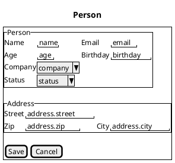
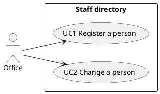

# spec/

This folder holds the specs of the project - the files you write. Pisa reads them and generates the
code from them; the generated code is never edited by hand.

| File | What it is | Needed |
|---|---|---|
| `<name>.dml` | The domain model: entities, fields, relations | yes |
| `domain-spec.md` | Free text about what the system stores; `pisa propose-model` reads it and proposes a `<name>.dml` (needs a language model) | no |
| `<entity>.ui.md` | Description and layout of one entity's form | no |
| `<name>.uc.md` | Use cases in Markdown; Pisa generates a browser test per use case from the `Form:` and `Test:` lines; an `Actor:` that is a role of the `.adl` (`USER`) makes the test run as that role | no |
| `architecture.md` | Free text about the architecture; `pisa propose-architecture` reads it and proposes `architecture.adl` (needs a language model) | no |
| `architecture.adl` | The architecture (database, backend style `crud`/`layered`, versions, package, and with a login the `roles` and what each may do, e.g. `USER { Company: read, update }`). Given to `pisa init --adl`; `generate` checks the project still matches it | no |

All `.dml` files in this folder form **one** model.

**What to do next:** copy the domain model example below into `spec/<name>.dml` (or write your own),
then run this from the project root:

```bash
pisa generate --file spec/<name>.dml --out .
mvn spring-boot:run          # then open http://localhost:8080/
```

`generate` checks the model first and writes nothing if it is wrong. Add a `<entity>.ui.md` later
to shape a form and run `generate` again; `generate` can be repeated at any time.

## Domain model (`.dml`)

```
type Zip = String ~ "[0-9]{4}"       // a named type: define the rules once, use it anywhere
enum Status { ACTIVE, SUSPENDED ("Blocked"), CLOSED }   // fixed values, optional text for the form

@table("T_PERSON")                   // the table name (optional; default: person)
entity Person {
    @id id: Long                     // exactly one @id per entity
    @column("C_NAME")                // the column name (optional; default: name)
    name: String(1..80)              // a range: for String the length, for numbers the value
    status: Status                   // an enum as the type of a field
    email: Email? unique             // ? = optional, unique = no duplicates
    age: Int(0..150)?
    birthday: Date?
    oneToOne address: Address composed
    manyToOne company: Company
}

entity Address {
    @id id: Long
    street: String
    zip: Zip
    city: String
}

entity Company {
    @id id: Long
    name: String
    oneToMany employees: Person mappedBy company
}
```

- Types: `String`, `Int`, `Long`, `Double`, `BigDecimal`, `Boolean`, `Date`, `DateTime`, and `Email`,
  `Url`, `Phone` (Strings with a format; an `Email` needs a domain ending, `foo@bar` is refused).
- Rules: `(min..max)` after the type, either bound may be left out: `Int(0..150)`, `String(..2000)`,
  `BigDecimal(0..)`. `~ "regex"` is a pattern the whole String must match: `String ~ "[0-9]{4}"` (write
  `"\\d{4}"` for the regex `\d{4}`). `type Zip = ...` names a type with its rules. A field without `?` is required.
- The rules are checked in the form (a wrong field turns red with its message; validator.js checks an
  `Email` and a `Url`), by the server (answer 400 with the message per field, shown the same way) and by
  the generated tests (a valid and an invalid value for each rule).
- `enum Status { ACTIVE, SUSPENDED ("Blocked") }`: fixed values in UPPER_SNAKE_CASE, the optional text is
  what the form shows. Use it as a type (`status: Status`, `?` makes it optional). It becomes a Java enum
  stored by name, and a select in the form (`^status^` in the Salt mockup). No range or pattern, not an `@id`.
- `@table("T")` before `entity` and `@column("C")` before a field set the table and column names;
  without them the names are derived. Letters, digits and `_` only.
- Relations: `oneToOne`, `oneToMany`, `manyToOne`, `manyToMany`. The owning side has the column;
  the other side says `mappedBy <field>`.
- `composed` makes the target a **part** of the entity (here the address of a person): it is saved,
  edited and deleted with it and has no page of its own.
- Every entity gets a REST resource and a page to list, create, edit and delete it. To allow less, write
  `@operations(create, read, update)` after `@table` and before `entity` (names from `create`, `read`, `update`,
  `delete`, `read` always among them): what is missing is answered with 405, the page has no button or form for it
  and the generated tests follow. Without `@operations` all four are allowed - nothing restricts an entity unless you
  write it. A composed part takes no `@operations` (put it on its owner).

## Form (`<entity>.ui.md`)

Without a form description every entity gets a default form. To control it, write
`spec/<entity>.ui.md` (for example `spec/person.ui.md`): free text, plus a PlantUML Salt mockup
that is the layout. The text in quotes is a field name from the `.dml` (a part's fields with a
path, like `address.city`); every field must appear exactly once.

````
# Form: Person

Name and email next to each other, then the address.


````

- `Label | "field"` is a field with a label; `A | "a" | B | "b"` puts two on one line.
- `Label | ^name^` is a choice, for a relation or an enum; `[ ] label` is a checkbox.
- `pisa propose-specs --out .` writes a `.ui.md` with a default mockup per entity and a `.uc.md` with
  create, edit and delete use cases from the model, without a language model (it never overwrites).
- `pisa propose-layout --entity Person --out .` lets a language model propose the mockup from
  your text instead (needs a model set up for `pi`, see the Pisa README); it writes the proposal into the file, where you can edit it.

If the mockup does not match the model, `generate` says which line is wrong and writes nothing.

## Use cases (`<name>.uc.md`)

Plain Markdown describing who does what with the system, with a PlantUML use-case diagram. It is
documentation for people. Pisa reads only the headings `## UC<n> <title>` and two lines per use case:

- `- **Form:** [Person](person.ui.md)` - the form the use case works in (a part such as `Address`
  means the form of its root).
- `- **Test:** create` - the scenario to test: `create`, `edit` or `delete` (German `anlegen`, `ändern`,
  `löschen` work too).

`pisa generate` writes one browser test per use case (`UC1UiTest`, tagged `UC1`, display name
`UC1 <title>`; run with `mvn test -Pui`). A use case without these lines gets a `@Disabled` test with
its steps as a comment, and `generate` says why. The diagram links (`[[person.ui.md]]`) are for people.

````
# Use cases: Staff directory

Model: `staff.dml` - Forms: `person.ui.md`



## UC1 Register a person

- **Actor:** Office
- **Goal:** A new person is stored with their address.
- **Form:** [Person](person.ui.md)
- **Test:** create
- **Data:** `Person` with its `Address` (part), reference to `Company`

**Steps**
1. The office opens the person form.
2. It enters name, email and birthday, then the address and the company.
3. It saves. Person and address are stored together.

**Alternatives**
- The email is already taken: the form shows the error and nothing is stored.

## UC2 Change a person

- **Actor:** Office
- **Goal:** The stored data of a person, including their address, is up to date.
- **Precondition:** The person is registered (UC1).
- **Form:** [Person](person.ui.md)
- **Test:** edit
- **Data:** `Person` with its `Address` (part), reference to `Company`

**Steps**
1. The office opens the person list and chooses "Edit" on the person.
2. The form shows the stored values. The office changes what is outdated, for example the street or the company.
3. It saves. The person and the address are updated together.

**Alternatives**
- The person was deleted in the meantime: saving fails with "not found" and nothing is changed.
- The office cancels: the form is cleared and nothing is changed.
````

## Tooling (optional)

- **Pisa plugin (DML, ADL)** for IntelliJ IDEA or VS Code: colors and error checking for `.dml` and `.adl` files, and on
  save it writes the class diagram of the model next to them (`domain-model.puml` and
  `domain-model.md`). IntelliJ also needs Node.js and the LSP4IJ plugin.
- **PlantUML** (plus Java and Graphviz) to see those diagrams and the Salt mockups in `.ui.md`
  as pictures: the "PlantUML integration" plugin in IntelliJ, or the "PlantUML" extension
  (`jebbs.plantuml`) in VS Code (its Markdown preview draws the diagrams through a PlantUML server: set `plantuml.server`, see the user guide). Pisa itself never calls PlantUML; it only reads and writes the text.

Install steps for all of these: the user guide, section "Editor und PlantUML einrichten".

More: the user guide and the two tutorials in `doc/` of this project (`doc/pisa-user-guide.md`; `pisa play spring-java` or `pisa play hono-typescript` plays a tutorial in a new folder).

