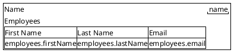

# Form: Company

The form of `Company`, proposed by `pisa propose-specs` from the domain model. The Salt mockup below is
the layout `pisa generate` renders: reorder the lines, group them in boxes, side by side in one line,
or change the labels. Every field of the model must appear exactly once.

