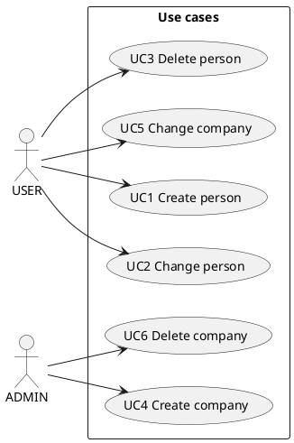

# Use cases

Proposed by `pisa propose-specs` from the domain model: edit the text, add actors and alternatives. The actor is a role of the login (`roles` in the .adl): `pisa generate` runs the browser test as that role.
`Form:` and `Test:` (create | edit | delete) make `pisa generate` write a browser test per use case.

## UC1 Create person

- **Actor:** USER
- **Goal:** A new person is stored.
- **Form:** [Person](person.ui.md)
- **Test:** create

**Steps**
1. Open the person form.
2. Fill in the fields.
3. Save. The new entry is in the list.

## UC2 Change person

- **Actor:** USER
- **Goal:** The data of a stored person is up to date.
- **Form:** [Person](person.ui.md)
- **Test:** edit

**Steps**
1. Open the person list and choose "Edit" on an entry.
2. Change the fields.
3. Save. The list shows the changed values.

## UC3 Delete person

- **Actor:** USER
- **Goal:** A person that is no longer needed is removed.
- **Form:** [Person](person.ui.md)
- **Test:** delete

**Steps**
1. Open the person list.
2. Choose "Delete" on the entry and confirm.
3. The entry is gone from the list.

## UC4 Create company

- **Actor:** ADMIN
- **Goal:** A new company is stored.
- **Form:** [Company](company.ui.md)
- **Test:** create

**Steps**
1. Open the company form.
2. Fill in the fields.
3. Save. The new entry is in the list.

## UC5 Change company

- **Actor:** USER
- **Goal:** The data of a stored company is up to date.
- **Form:** [Company](company.ui.md)
- **Test:** edit

**Steps**
1. Open the company list and choose "Edit" on an entry.
2. Change the fields.
3. Save. The list shows the changed values.

## UC6 Delete company

- **Actor:** ADMIN
- **Goal:** A company that is no longer needed is removed.
- **Form:** [Company](company.ui.md)
- **Test:** delete

**Steps**
1. Open the company list.
2. Choose "Delete" on the entry and confirm.
3. The entry is gone from the list.
